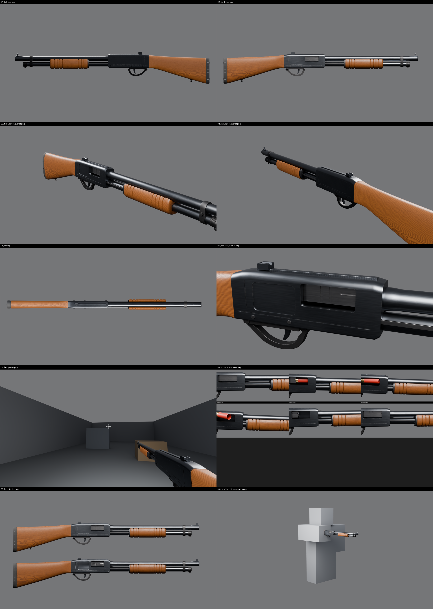

# Double Pump — Pump Shotgun asset

The signature weapon of Double Pump: an original pump-action shotgun in the spirit of
the 2017–2018 Fortnite pump (dark blued receiver, warm wood pump and stock, stacked
barrel and tube), built procedurally in Blender so every part stays editable.



Both weapon slots use this one asset: instantiate it twice, each copy with its own
AnimationController, cooldown and state.

## Contents

```
PumpShotgun/
├── README.md                 this file
├── VALIDATION.md             latest automated validation report (scripts/08_validate.py)
├── references/               research: sources, visual analysis, dimensions, mood board
├── blender/
│   ├── PumpShotgun_Master.blend   master model + rig + actions + FP/TP variants + demo camera
│   └── PumpShotgun_Blockout.blend Phase 2 proportion blockout
├── scripts/                  every script used to build, bake, animate, export, render, validate
├── textures/
│   ├── first_person/         2048² BaseColor / Normal / Roughness / Metalness (source quality)
│   ├── roblox_1024/          the same maps at 1024² (Roblox SurfaceAppearance limit)
│   └── third_person/         1024² set for the world model (normal re-baked onto the low-poly mesh)
├── exports/
│   ├── first_person/         PumpShotgun_FP.fbx (rig + meshes), PumpShotgun_FP.glb (+ all animations)
│   ├── third_person/         PumpShotgun_TP.fbx, PumpShotgun_TP.glb (+ pump animation)
│   ├── animations/           one FBX per action + animation_events.json
│   ├── props/                Shell_Live.fbx, Shell_Spent.fbx (static, centred, for physics shells)
│   ├── attachments.json      reference bones in Blender and Roblox space + viewmodel camera offset
│   └── validation.json       machine-readable validation results
└── renders/                  presentation and QA renders (see "Renders")
```

## The model

| | First-person viewmodel | Third-person world model |
|---|---|---|
| Mesh | `FP_PumpShotgun` (+ `FP_Shell_Live`, `FP_Shell_Spent`) | `TP_PumpShotgun` |
| Triangles | 22,962 gun + 960 shells = **23,922** | **5,676** |
| Textures | 2048² PBR (1024² copies for Roblox) | 1024² PBR |
| Materials | 1 (`M_PumpShotgun`) | 1 (`M_PumpShotgun_TP`) |
| Rig | `Rig_PumpShotgun`, 13 bones | `TP_Rig`, 7 bones |

Overall size: **1.035 × 0.054 × 0.168 m** (length × width × height), about 3.7 studs.

### Master components (`PumpShotgun_Master` collection)
Separate, named objects, each rigid-skinned to one bone:

- **Weapon bone:** Receiver (ejection port, loading port, bolt channel, action-bar slots, seams and relief
  panels cut with booleans), SightRib (serrated), RearSight, ReceiverPins, TriggerPlate, TriggerGuard (with
  crossbolt safety and slide-release lever), Barrel (crowned, hollow bore), FrontSight (ramp + post), MagTube,
  MagCap (grip rings, sling eye), BarrelBand (two-piece clamp, hex boss), Stock, ButtPad (ribbed rubber),
  PadScrews, SlingStud
- **Pump bone:** Pump (grooved wood forend with barrel saddle), PumpFerrule, ActionBars
- **Bolt / Trigger / ShellCarrier bones:** Bolt (face recess, extractor slot), Trigger, ShellCarrier
- **ShellSpent / ShellLive bones:** Shell_Spent, Shell_Live (brass head + red hull)

Detail that shapes the silhouette or is visible in first person is real geometry; wood grain, pores,
machining streaks, pitting, rib serrations and edge wear are in the baked maps.

### Rig and reference bones
Every bone points +Y (towards the muzzle) with roll 0, so bone-local Y is "along the bore".

| Bone | Parent | Deforms | Purpose |
|---|---|---|---|
| ViewmodelRoot | – | no | root / pivot of the viewmodel (gun-space origin) |
| Weapon | ViewmodelRoot | yes | whole gun; recoil/sway pivot at the wrist |
| Pump | Weapon | yes | forend + action bars; translate −Y by up to 0.092 m |
| Bolt | Weapon | yes | travels with the pump |
| Trigger | Weapon | yes | rotates about X (−14° = pulled) |
| ShellCarrier | Weapon | yes | lifter, pivots at its rear |
| ShellSpent | Weapon | yes | spent hull for the eject beat (rests hidden in the chamber) |
| ShellLive | Weapon | yes | live shell for reloads (rests hidden inside the tube) |
| Grip | Weapon | no | right-hand grip point (wrist) |
| Muzzle | Weapon | no | muzzle centre (flash, raycast origin) |
| ShellEject | Weapon | no | outside the ejection port (spawn physics shells here) |
| ShellLoad | Weapon | no | loading-port mouth |
| SupportHand | Pump | no | left-hand point under the forend (moves with the pump) |

In Roblox, imported bones become `Bone` instances, and `Bone` inherits from `Attachment`, so the reference
bones can be used anywhere an Attachment is expected. Their positions in studs are in
`exports/attachments.json`. The TP rig keeps ViewmodelRoot, Weapon, Pump, Grip, Muzzle, ShellEject and
SupportHand.

## Animations

Authored at **60 fps**, each in its own action starting at frame 0, keyed on bones only.
Nothing encodes cooldowns: gameplay chooses when to play each track and can scale speed
(`AnimationTrack:AdjustSpeed`) to match tuned timings. Events are listed with times in
`exports/animations/animation_events.json` (FBX does not carry markers).

| Action | Frames | Duration | Loop | Events (frame) | Notes |
|---|---|---|---|---|---|
| PumpShotgun_Idle | 0–240 | 4.00 s | yes | – | subtle sway |
| PumpShotgun_Fire | 0–18 | 0.30 s | no | Fire (0), RecoverEnd (12) | back 34 mm, muzzle up 7.5°, trigger pull |
| PumpShotgun_Pump | 0–30 | 0.50 s | no | EjectShell (8), PumpBack (11), PumpForward (26) | full 92 mm stroke, bolt, carrier, spent hull out of the port |
| PumpShotgun_ReloadStart | 0–18 | 0.30 s | no | ReadyToInsert (18) | rolls the gun 32° to present the loading port |
| PumpShotgun_ReloadInsert | 0–36 | 0.60 s | no | ShellInserted (22), InsertEnd (36) | one shell; start and end poses match so it repeats |
| PumpShotgun_ReloadEnd | 0–18 | 0.30 s | no | ReloadDone (18) | back to ready |
| PumpShotgun_Equip | 0–24 | 0.40 s | no | Ready (20) | full raise from below the screen |
| PumpShotgun_SwapIn | 0–9 | 0.15 s | no | Ready (7) | fast raise for the double-pump swap |
| PumpShotgun_Unequip | 0–9 | 0.15 s | no | Hidden (6) | fast drop out of view |
| PumpShotgun_TP_Pump | 0–30 | 0.50 s | no | as Pump | world model: forend only |

**Reload is interruptible**: play ReloadStart, then ReloadInsert once per shell; after any
`ShellInserted` the code may stop the loop and play ReloadEnd (or go straight to Fire).
**Double pump**: Unequip on the outgoing copy and SwapIn on the incoming copy can run
simultaneously; their speed is the main feel knob.

The spent shell rides the bolt and flips out of the port during Pump, then holds outside until
the last frame. In game, hide `FP_Shell_Spent` (Transparency) at `EjectShell` and spawn
`props/Shell_Spent` at the `ShellEject` bone with physics. Likewise show `FP_Shell_Live` only
during ReloadInsert.

## Scale and orientation

- Blender: 1 unit = 1 m, real-world scale. Muzzle +Y, right side (ejection port) +X, up +Z.
- Exports: FBX written in metres (`UnitScaleFactor = 100`, i.e. cm-per-unit), axes converted so
  **muzzle = −Z** (Roblox `LookVector`) and **up = +Y**. The glTF files use the same orientation
  (checked by `08_validate.py`).
- Roblox: 1 stud = 0.28 m, so the gun is **≈ 3.70 studs** long (0.19 × 3.70 × 0.60 studs).
  Next to a 5.2-stud R15 character that is about 70 % of body height
  (`renders/09c_tp_with_r15_mannequin.png`); if it reads too large for third person,
  scale the world model in Studio (the FP framing is unaffected).

## Viewmodel framing

`FP_DemoCamera` (in the `_Demo` collection, never exported) uses Roblox's default
**70° vertical** field of view. The camera sits 0.18 m left, 0.34 m behind and 0.11 m above the
gun origin, yawed 8° left and pitched 5° up (`scripts/05_variants.py`, `CAM_LOC` / `CAM_YAW_DEG` /
`CAM_PITCH_DEG`). The mesh itself is not moved; instead the equivalent offset is exported as a
Roblox CFrame (studs) in `attachments.json → viewmodel_demo_camera.viewmodel_offset_cframe`:

```lua
local OFFSET = CFrame.new(unpack(VIEWMODEL_OFFSET)) -- 12 numbers from attachments.json
RunService.RenderStepped:Connect(function()
    viewmodel:PivotTo(workspace.CurrentCamera.CFrame * OFFSET)
end)
```

## Importing into Roblox Studio (not yet tested in Studio)

These steps follow Roblox's documented importer behaviour; they have **not** been run in Studio yet.

1. **Mesh + rig.** Studio → *File / Home → Import 3D* → `exports/first_person/PumpShotgun_FP.fbx`.
   In the import settings check that the file units are read as metres (preview length ≈ 3.7 studs; if
   it shows ≈ 0.04 or ≈ 370, set the scale unit to *Meter*). Keep "Import as model". The result should be a
   Model with three MeshParts and the bone hierarchy. Set the Model's PrimaryPart/pivot to the part that holds
   `ViewmodelRoot`.
2. **Materials.** If the importer did not create one, add a `SurfaceAppearance` to each MeshPart and set
   ColorMap, NormalMap, RoughnessMap, MetalnessMap to the four files in `textures/roblox_1024/`
   (normals are tangent-space OpenGL, as Roblox requires). Shells use the same textures.
3. **Animations.** Add an `AnimationController` with an `Animator` to the model. Open the Animation Editor,
   select the model, then *… → Import → From FBX Animation* and pick a file from `exports/animations/`.
   Publish each one and record its AnimationId. Optionally add Animation Events from
   `animation_events.json` in the editor so `GetMarkerReachedSignal` works.
4. **Third person.** Import `exports/third_person/PumpShotgun_TP.fbx` the same way with
   `textures/third_person/`. For a `Tool`, use the imported mesh as `Handle` and set `Tool.Grip` so the `Grip`
   bone lands on the hand's `RightGripAttachment` (its root-relative CFrame is in `attachments.json`).
   `PumpShotgun_TP_Pump.fbx` animates the forend.
5. **Shells.** Import `exports/props/Shell_Spent.fbx` once and clone it for physics casings.

If an attachment does not come through as a usable Bone, recreate it as an `Attachment` at the
`roblox_cframe_from_root` listed for that bone in `attachments.json`.

## Rebuilding / editing

Everything is generated by the scripts, in order (`scripts/run_all.sh`):

| Script | Phase | Does |
|---|---|---|
| `01_blockout.py` | 2 | proportion blockout + renders |
| `02_build_master.py` | 3 | all parts (`sg_parts.py`, one function per part) + rig |
| `03_bake_textures.py` | 4 | UV atlas, bakes procedural materials (`sg_materials.py`) to PBR maps |
| `04_animate.py` | 5 | actions + `animation_events.json` |
| `05_variants.py` | 6 | FP join, TP decimation + normal re-bake, demo camera |
| `06_export.py` | 7 | FBX / glTF / animation / prop exports, `attachments.json` |
| `07_render.py` | 8 | presentation renders |
| `08_validate.py` | 9 | automated checks → `VALIDATION.md` |
| `check_intersections.py` | 9 | moving-vs-static clearance on every sampled animation frame |
| `render_views.py` | – | quick clay/material inspection renders |

All proportions live in `sg_dims.py`; change a number and re-run. The scripts need a Python with
the `bpy` module (`pip install bpy==5.2.2`, Python 3.13) or Blender 5.2 (`blender -b --python 02_build_master.py`).
The `.blend` is saved by **Blender 5.2**; open it with 5.2 or newer.

## Renders

| File | Shows |
|---|---|
| 01_left_side / 02_right_side | side profiles |
| 03_front_three_quarter / 04_rear_three_quarter | three-quarter views |
| 05_top | top view |
| 06_receiver_closeup (+06b–06f) | receiver both sides, muzzle, loading port, pump, stock |
| 07_first_person (+07b fire, 07c reload) | through the demo camera, 70° vFOV, with crosshair |
| 08_pump_action_poses (+08b reload, 08f FP pump-back) | pump cycle frames 0/6/9/11/18/26 |
| 09_fp_vs_tp_side / 09b | master (top) vs world model (bottom) |
| 09c / 09d | world model with an R15-proportioned mannequin |
| 10_topology_* | clay + wireframe, master and world model |
| blockout/ | Phase 2 blockout views |

## Known limitations

- **Roblox Studio import has not been tested.** All validation ran in headless Blender (re-import of every
  export). The next step is a Studio import on Aaron's PC.
- **Reference images were not viewed.** The container could not download images (wiki/Wikimedia/YouTube
  hosts blocked), so the design follows text sources, real 870 specs and recollection; see
  `references/REFERENCES.md`. Compare the renders with the mood-board links before sign-off.
- Roblox documents a 1024² limit for SurfaceAppearance maps; the 2048² set is the source, and the 1024² set
  is what Studio should get.
- The ejection port is on the right, so the default first-person view shows the gun's left side; the
  port reads mostly through the shell-eject beat.
- No arms or hands yet (Grip / SupportHand bones are ready for them).
- Boolean cuts leave some long, thin triangles on the receiver; shading is clean thanks to weighted normals
  (`renders/10_topology_master_receiver.png`), but a manual retopo pass would tidy it.
- Animation events are not stored inside the FBX files; they are in `animation_events.json`.
- The TP glTF names its single animation "Animation" (the FBX names it correctly).
