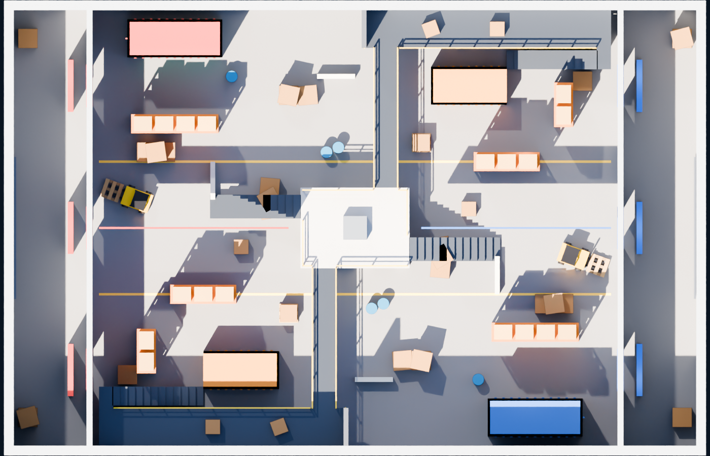
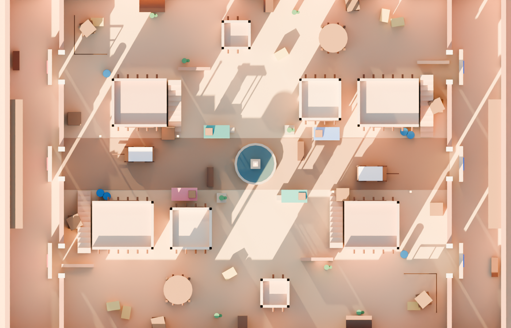
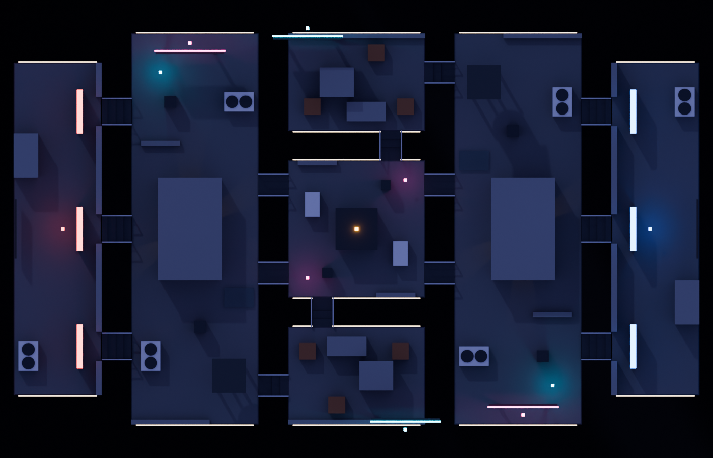

## 2026-10-21 - Permanent firing-range lobby and voluntary queue

Implemented a server-owned physical FIFO queue (2-10 players, 15 seconds), selected-roster map voting, nonlethal range PvP using the existing pellet damage pipeline, and full-health/ammo return to the lobby. Healthy transfers retain the prepared avatar; real deaths retain normal respawns. Base a487de38 with existing mobile/camera changes preserved; no commit/push. 245 tests pass; staged three-client Studio cycles verified all three arenas, real match PvP and return/requeue, plus an actual fourth late join. See `LOBBY_AND_MATCHMAKING_UPDATE.md` and `docs/lobby-matchmaking-evidence/` for exact evidence, initial failed probes and limitations. Private publication is tracked in the report. Weapon balance, control implementations and arena source files remain unchanged.

# Double Pump: game design

A 5v5 first-person team deathmatch on Roblox where everyone carries two identical pump
shotguns. Each gun has its own pump cycle, so a fast player fires one, swaps, and fires
the other before the first has finished pumping: the "double pump". The swap is always a
deliberate player input; the game never does it for you.

All numbers below live in config files and are starting values for playtesting, not
final balance.

## The weapon

Both slots hold the same pump shotgun (`src/shared/Config/WeaponConfig.luau`).

| | Value |
|---|---|
| Shells per gun | 5, infinite reserve, auto-reload when empty |
| Same-gun cooldown (fire + pump) | 1.0 s |
| Minimum time between any two shots | 0.4 s (the fastest double pump) |
| Swap time | 0.15 s, so the 0.4 s rule is what limits a double pump |
| Equip on spawn | 0.35 s |
| Reload | 0.3 s start + 0.5 s per shell; firing or swapping interrupts it and keeps loaded shells |
| Pellets | 10 × 9 damage, fixed pattern (centre, ring of 3, ring of 6), rotated 17° per shot |
| Multipliers | head 1.75, torso 1.0, arm 0.9, leg 0.8 |
| Falloff | full to 9 studs, linear down to 25% at 45 studs, nothing past 150 |
| Crouch / airborne spread | ×0.9 / ×1.15 |

A point-blank body shot with every pellet is 90 damage; with every pellet on the head it's
157. So one perfect shot can kill a 100 HP player, and a typical close-range hit followed by
a double pump finishes them. A kill counts as a **double pump** when the killing shot comes
from the other gun within 1.2 s of a hit on the same target.

Each gun keeps its own ammo, cooldown and reload. Swapping never fires, firing never swaps,
and holding fire doesn't auto-fire (a press buffered up to 0.1 s early fires the instant
the gun is ready).

### Controls

| Action | Keyboard & mouse | Controller | Touch |
|---|---|---|---|
| Fire | Left mouse | R2 | FIRE (drag it to aim) |
| Gun 1 / Gun 2 | 1 / 2 | D-pad left / right | 1 / 2 |
| Swap | Q, or the mouse wheel (can be turned off in Settings) | R1 or L1 | SWAP |
| Reload | R | X | R |
| Crouch | C or Left Ctrl (hold or toggle) | B | C |
| Jump | Space | A | Roblox jump button |
| Scoreboard | Tab | Select | ≡ |
| Menu | M | Start | II |

Touch buttons can be moved and resized in Settings.

### Server authority

The client predicts its own shots for responsiveness, but the server owns every result
(`src/server/Services/CombatService.luau`, `src/shared/Weapons/WeaponState.luau`):

- each gun's state machine runs on the server, so ammo, cooldowns, the 0.4 s rule and
  reload are checked there with a small, non-accumulating jitter allowance;
- the shot origin must be near the server's view of the player's head (allowance grows
  with ping) and the aim direction must be sane;
- pellets are re-traced on the server against rewound hitboxes; walls block them;
- damage, kills, assists and double pumps are decided on the server only;
- every remote is rate-limited and type-checked.

## Movement and camera

First person only. WASD at 20 studs/s, crouch at 11 (the hitbox really lowers), jump
height 7.6 studs, limited air control. No sprint (it's in config, off), no building,
wall-running, grappling or sliding. Field of view defaults to 78° vertical (about 108°
horizontal at 16:9) and can be set from 60 to 95.

## Match flow

Team deathmatch, Red vs Blue, up to 5 per team (`GameConfig.luau`,
`src/server/Services/MatchService.luau`).

1. **Practice**: with fewer than 2 players the server sits in a practice range with
   standing, strafing and jumping dummies.
2. **Intermission** (10 s) once 2+ players are in, then **countdown** (5 s, frozen at
   spawn).
3. **Combat**: 5 minutes or first team to the score target. The target is 40 at 10 players
   and scales down for small lobbies (never under 15).
4. **Overtime** if tied: 60 s sudden death; still tied is a draw.
5. **Results** (9 s): winner, MVP, scoreboard, XP and coins earned.
6. **Map vote** (12 s) between the three maps, then back to step 2.

Respawn takes 2.5 s at a spawn away from enemies, with 2 s of spawn protection that ends
early when you fire. Joining players go to the smaller team; when a team is ahead by 2
players, a dead player from the bigger team moves over. Falling below a map's kill height
eliminates you.

The kill feed shows headshots and double pumps. Hitmarkers distinguish body and head hits,
and a double-pump elimination gets its own callout and sound.

## Maps

All three maps are built in code from parts (`src/server/Maps/`), point-symmetric so
both teams get the same layout, with walled spawn rooms. Automated checks
(`tests/maps.spec.luau`) confirm every map has 7 spawns per team, no spawn can see an
enemy spawn, the layout is fully symmetric, and three quarters of sightlines are under 40
studs (shotgun range).

| | Warehouse | Dust Town | Rooftops |
|---|---|---|---|
| Feel | Indoor, daytime, tall racks and containers, an office you can climb | Bright desert town, adobe buildings with roof access | Night city, rooftops linked by bridges, falls are lethal |
| Median sightline | 15 studs | 14 studs | 17 studs |

These are offline Blender renders of the exact map geometry, not in-game screenshots.

## Progression

Everything earned comes from server-side match stats (`src/shared/Progression/`,
`src/server/Services/ProgressionService.luau`).

- **XP**: 50 per elimination, 20 per assist, +10 headshot bonus, +25 double-pump bonus,
  100 for completing a match and 150 for a win (scaled by time played). Levels 1 to 100;
  level 2 takes 400 XP, rising 100 per level to a cap of 2,000 per level.
- **Anti-idle**: the server counts seconds where you moved, turned or fired. Below 35%
  active time you get no completion or win reward and the match doesn't count toward
  match-based challenges.
- **Coins**: 5 per elimination, 25 per completed match, 50 per win, plus challenge rewards.
- **Mastery**: shotgun eliminations unlock Bronze (25), Silver (100), Gold (250), Diamond
  (500) and Pump Master (1,000), each with a skin.
- **Challenges**: 3 daily and 3 weekly, chosen from pools of 8 and 6 by date, so every
  server shows the same ones.
- **Stats**: kills, deaths, assists, headshots, double pumps, damage, accuracy, wins,
  losses, matches and time played.
- **Leaderboards**: all-time kills, wins, double pumps and XP.

## Cosmetics and monetization

Cosmetic only; nothing affects combat. 16 shotgun skins (colour schemes): some bought
with coins (150 to 500), some unlocked by level or mastery. Coin packs for Robux exist in
code but are **off** and have no product IDs until the owner sets them up
(`docs/PUBLISHING.md`).

## Saving

One profile per player in `DoublePump_Profiles_v1`, with a session lock so two servers
can't overwrite each other, retries with backoff, autosave every 90 s, and a save on
leave and on shutdown. Old or damaged profiles are repaired on load. If DataStores are
unavailable the game keeps progress in memory and tells the player it won't save.

## Audio and visuals

Every sound was synthesised for this game (`tools/gen_audio.py`); the shotgun was modelled
in Blender for it; maps and UI are built in code. See `docs/ASSET_SOURCES.md`. Settings
include volume per channel, crosshair style, colour and size, reduced effects, camera bob
and damage numbers.

## Mobile controls, private version 5 (2026-10-21)

Touch controls now use separate movement/look sticks, a held FIRE pad and a fresh
quick downward swipe outside the movement stick. Each swipe deliberately switches
weapons and, while FIRE remains held, queues at most one shot until the existing
weapon state permits it. Holding FIRE alone does not repeat. This mobile input
preference leaves all numbers and desktop/gamepad behavior above unchanged.
Settings offers Right-Handed/Left-Handed; touch UI and local first-person presentation
mirror without reversing world movement/aim or changing third-person guns/damage.
See MOBILE_CONTROLS_UPDATE.md. Studio checks pass; private version 5 contains this
update. Physical multitouch and live rejoin persistence remain unverified.

## Touch camera / independent hand revision (2026-10-21)

LOOK has been removed; free-screen finger displacement uses the original touch
camera sensitivity. Control Layout controls only touch layout. Weapon Hand controls
only first-person presentation on mobile and desktop; both save independently.
Remaining buttons and swipe/fire sequence retain version 5 geometry and behavior.
See MOBILE_CAMERA_AND_HANDEDNESS_UPDATE.md for verification/publication status.

## Promotional assets — 2026-10-21

Marketing-only artwork is in marketing/. It represents the existing pump-shotgun
combat, manual swapping, 5v5 format and current arenas. It does not add gameplay
features. See marketing/MARKETING_ASSET_REPORT.md for illustration provenance.
