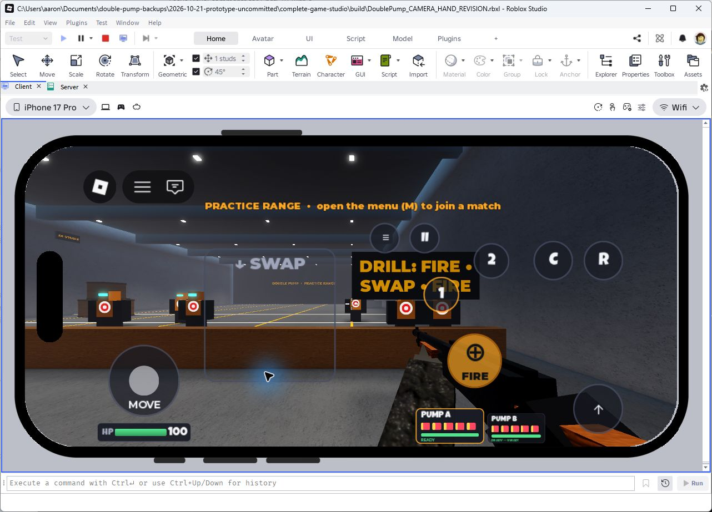
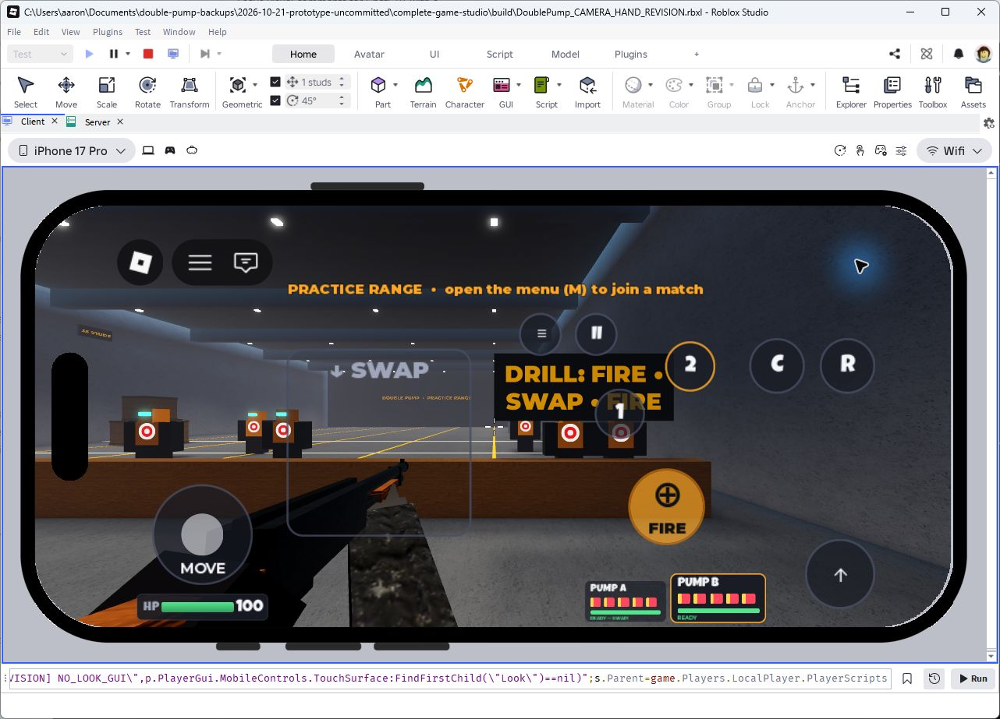
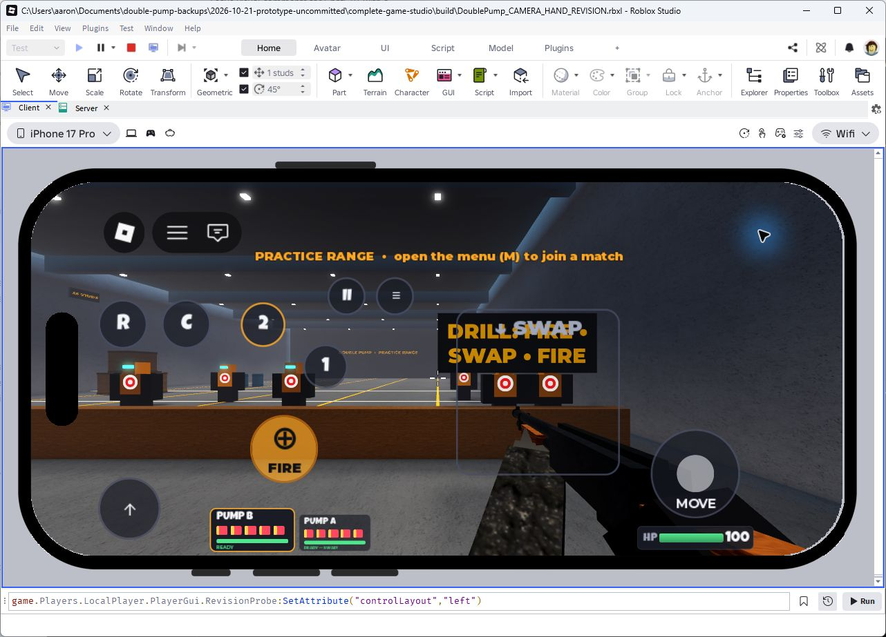
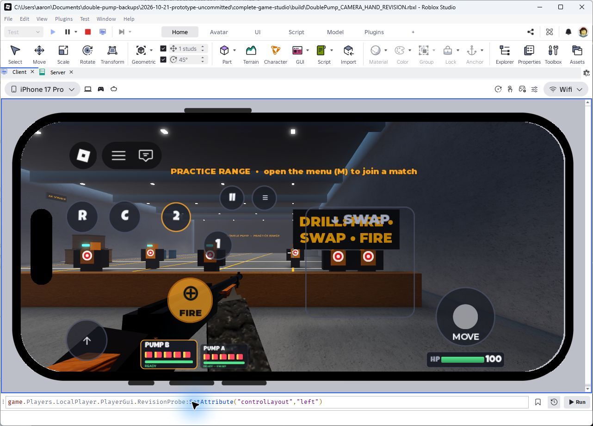
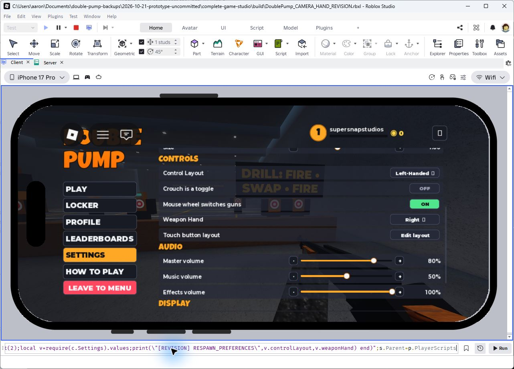
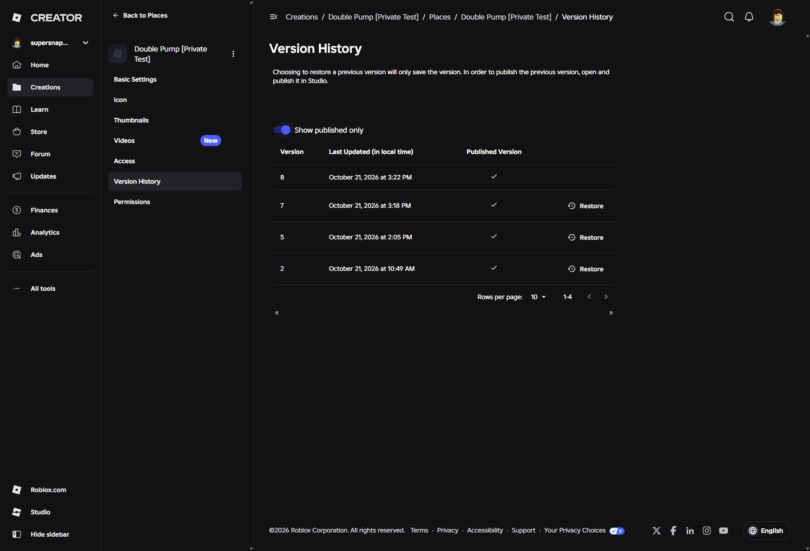
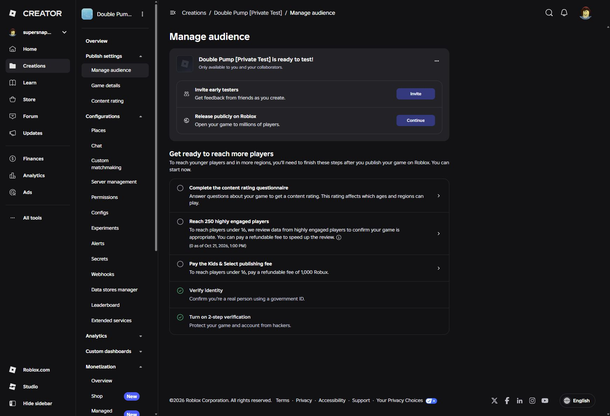
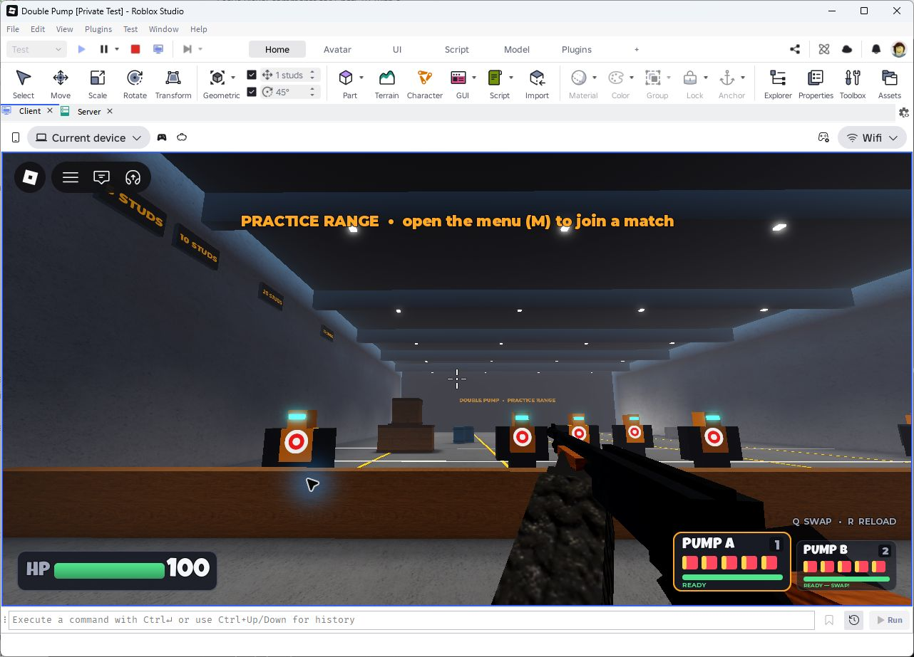

# Mobile camera and handedness update

2026-10-21. Implemented, Studio verified and privately published as version 8. This report supersedes the LOOK-stick instructions in the
historical MOBILE_CONTROLS_UPDATE.md.

## Preservation and source

Authoritative checkout: `complete-game-studio`, branch `feat/mobile-controls`, base
`a487de38a96261dbeac74e701e69ce31762123f9`, with the existing uncommitted mobile work.
No reset, merge, commit or push. Original prototype checkout/backup untouched.

Before editing, source/tests, version 5 local/cloud places and a tracked binary
patch/status were saved in `../before-camera-hand-revision-2026-10-21/`.
The independent original stable version 2 backup remains intact as well.
Owner reported successful version 5 play on **iPhone 17 Pro Max**, with no technical
issues, and requested these two revisions. That hardware result belongs to version 5,
not the revised build.

Build: `build/DoublePump_CAMERA_HAND_REVISION.rbxl`. Local source/build comparison
passes for **78 scripts**, with no extra test scripts and original place settings.
Final hashes and verification logs are in `docs/camera-hand-evidence/`.

## Restored touch aiming

The original camera from checkpoint a487de3 was custom Scriptable first-person
code, not Roblox's default camera. Restored its exact displacement calculation:
`yaw -= delta.X * GameConfig.Camera.TouchRadiansPerPixel * touchSensitivity`, with
the same pitch calculation, clamp, recoil and FOV behavior. No rate joystick,
deadzone, held-displacement velocity or joystick multiplier remains.

Removed the LOOK button, Thumb, input role/knob updates, mobile-stick state, look
response function and Layout.Look configuration. No LOOK rectangle is returned by
the layout and no hidden GUI/input region replaces it. Its former space accepts
normal free-screen dragging. Only one free-screen touch owns camera deltas until
release; other fingers retain buttons, movement and the explicit SWAP region.
A touch keeps its starting ownership when crossing another region. Menus, focus
loss, character reset/death clear aiming ownership and queued deltas.

The same original mouse/gamepad calculations are retained; touch mode suppresses
synthetic mouse deltas as version 5 did, preventing duplicate camera rotation.
The old hard left-40% camera exclusion is replaced by actual control bounds so both
mirrored layouts can aim in their free space. SWAP owns its full existing region,
even for invalid/slow gestures; these touches do not rotate the camera.

Every other button/HUD rectangle, size and style remains unchanged. Legacy v2
saved-position validation uses a temporary geometry constraint so removing LOOK
does not suddenly activate an old previously rejected override on another button.
This compatibility constraint is removed before layout output; it creates no
GUI, visible control or interactive touch reservation.

## Independent preferences and migration

- **Control Layout**: Right-Handed / Left-Handed, stored `controlLayout = right/left`.
  Affects touch controls, ammo/health and SWAP region only.
- **Weapon Hand**: Right / Left, stored `weaponHand = right/left`. Available on
  desktop too. Affects only the local first-person weapon and both shotgun slots.

All four combinations apply immediately. Existing presentation transforms, arm
assignments, recoil/pump/reload/equip animations and muzzle/shell calculations are
reused. World movement/camera directions, third-person rigs, shot rays and server
hit detection do not depend on either preference.

Profile version **3** migrates old `Left-Handed`/`Right-Handed` values to canonical
lowercase. Missing Weapon Hand inherits the old layout, preserving previous weapon
presentation. Explicit new Weapon Hand stays independent. New players default both
right. Legacy button data, progress, currency and receipts are preserved. DataStore
name remains **DoublePump_Profiles_v1**. Client load, server whitelist/save and profile
sanitization use the existing debounced persistence pipeline.

## Changed source files (relative to version 5)

- Controllers/CameraController: original drag rotation, separate free-touch ownership.
- Controllers/Settings: canonical independent defaults/load.
- Controllers/ViewmodelController: reads weaponHand on all devices.
- UI/MobileControls: remove LOOK, preserve other controls/swipe/held-fire wiring.
- UI/Hud: reads canonical controlLayout; unchanged layout geometry.
- UI/SettingsPanel: independent labels/options, including desktop Weapon Hand.
- UI/MainMenu: touch-drag instructions.
- shared/Mobile/Layout and TouchState: remove exposed LOOK geometry/response.
- shared/Preferences (new): shared legacy/canonical normalization.
- shared/Mobile/DragAim (new): exclusive free-drag ownership, no sensitivity/timing.
- shared/Progression/Profile and server/Services/ProgressionService: migration/save.
- tests/camera_handedness.spec, mobile_controls.spec and fixtures/MobileLayoutV5.

Full source roots are src/client/, src/shared/ and src/server/ as appropriate.
FireSequence, WeaponController, MovementController, CombatService, GameConfig and
WeaponConfig match the pre-revision snapshot byte-for-byte after line normalization.
Gesture thresholds stay 0.30 s / 72 responsive pixels / 1.8 dominance / 16 upward.
Cooldowns remain 1.0 s same-gun, 0.4 s global, 0.15 s swap, 0.35 s spawn equip.
No maps, rules, progression rewards, assets, product settings or desktop bindings changed.

## Automated validation

**197 passed, 0 failed** (168 previous + 29 new). Obsolete LOOK-response assertions
were replaced by movement-stick assertions; remaining combat/swipe assertions stay.
New coverage: exact drag deltas, release/reset ownership, blocked/control fingers,
all four independent profile combinations, legacy migration, invalid values and
independent settings-save payload. Layout regression compares every remaining
rectangle to the exact version 5 fixture across 9 phone/tablet/portrait sizes, both
hands, defaults and saved overrides. No LOOK hit bounds remain.

Rojo passes; all 78 built sources match local files. Luau LSP: no source diagnostics
(existing definitions/file-watch informational warning only). StyLua passes using
Windows line endings. Selene: 0 errors, 0 warnings, 0 parse errors. Exact logs retained.

## Actual Studio observations

Windows / Studio 0.744.0.7441077, iPhone 17 Pro emulator (not Pro Max hardware).
Practice loaded with visible targets and HP 100. No LOOK button/thumb or replacement
hit region appeared. Horizontal, vertical, diagonal and downward free drags moved
the camera in the expected directions, including the old LOOK area and left-layout
free area. Downward aiming outside SWAP did not equip another gun. Valid downward
SWAP on both sides equipped once without steering the camera. Button taps did not aim.

Immediately on touch-up the queued final displacement can finish on the next render
frame (as in the original drag camera); this is not held velocity. A settled probe
measured **0 yaw / 0 pitch drift** between 0.1 and 0.5 seconds after release.

All four UI/hand combinations were visually inspected and captured. Weapon Hand
was changed with the actual settings selector; Control Layout was also toggled
through its selector. Other button positions stayed fixed within each layout.
The server GetProfile returned **controlLayout left / weaponHand right** after save.
Actual core-menu respawn preserved that independent pair, restored controls/weapon
and touch dragging worked afterward. Live DataStore rejoin remains unverified.

Both A and B fired with ammo reduction and matching server snapshots. Left-side
weapon firing/reload presentation was inspected; reload restored B to five shells.
Temporary real-server FireSequence instrumentation passed hold-once, alternating
follow-ups and release cancellation: shot 3 at 1792619878.406744, shot 4 at
1792619878.860379, shot 5 at 1792619879.464612. Intervals **0.453635 / 0.604233 s**;
same-gun interval 1.057868 s. Counters matched, no shot rejection. This uses simulated
intent and is not a physical simultaneous-finger test. Runtime probes live only in
Play and are removed by stopping; none are included in the build.

Screenshots in docs/camera-hand-evidence/:
01 right UI/right weapon; 02 right UI/left weapon; 03 left UI/right weapon;
04 left UI/left weapon; 05 both settings; 06 post-respawn; 07 desktop mouse/Q/R smoke test. Desktop fire, swap and reload
were observed with the original HUD and camera behavior. The first four also show
the complete absence of LOOK and unchanged surrounding buttons.

## Remaining limitations / owner test

The revised build has not yet been tested on physical hardware. The owner's iPhone
17 Pro Max success applies to the preceding joystick build. Test four independent
combinations, free drag + held FIRE + separate SWAP + MOVE, invalid swipes, release
cancellation, crouch/jump/reload, respawn, map/mode transitions and rejoin saving.
Emulation/simulated intent is not equivalent to real multitouch. No device FPS,
memory or latency measurements, video, full PvP/map-cycle regression or pixel-level
muzzle/shell alignment audit is claimed for this targeted revision. Existing missing/
moderated sound warnings and avatar mesh warnings remain unchanged. No assets uploaded.

## Private publication

Only existing Double Pump [Private Test], universe **10772275012**, start place
**82505574993280**, is authorized. URL:
https://www.roblox.com/games/82505574993280/Double-Pump
Version **8** published at 2026-10-21 22:23:15 UTC (3:23 PM local Studio log;
Dashboard version timestamp 3:22 PM). Published-only history includes 8, 7, 5, 2.
Version 7 was the successful retry; version 8 explicitly published the latest save.
Dashboard confirms **Only available to you and your collaborators**. Access and
monetization settings were not changed. Version 5 remains available for rollback.
Independently reopened the existing cloud place in another Studio window and
Downloaded a Copy: build/DoublePump_CAMERA_HAND_CLOUD_DOWNLOADED.rbxl. All 78
sources match the tested candidate; no runtime probes. See cloud-source-verification.log.
The independently reopened cloud build loaded its main menu and practice range,
with targets, HP 100 and the shotgun visible (screenshot 11). No new source runtime
exception appeared. Studio DataStore access is disabled (StudioAccessToApisNotAllowed),
so this smoke test used fallback settings and does not prove live rejoin persistence.
The existing unapproved swoosh.wav warning remains. Download a Copy saves a cloud
draft before downloading; that later saved draft is not a new published release.
Normal Roblox Player and physical multitouch remain owner verification tasks.
No public access, monetization, new experience, commit or push is authorized.

## Publication recovery

Two older version 5 Studio sessions prevented publication. With explicit owner
approval, only those exact processes/windows were force-closed. The tested revision
window was preserved. Retry and normal Publish then succeeded for the existing
place. Screenshot 08 records the historical failure; 09 records published version 8,
and 10 records unchanged private access. A normal close of the publishing editor
again showed Studio's Applying script changes notice; it was not force-closed.
A separate Studio start page successfully reopened the cloud place for comparison.

Final recoverable source/tests ZIP, tracked patch/status, report, evidence and
candidate/Studio/cloud places are in ../camera-hand-verified-2026-10-21/.
Pre-revision source/version 5 remains in ../before-camera-hand-revision-2026-10-21/.
No commit, push, merge or history rewrite occurred.

## Visual evidence

