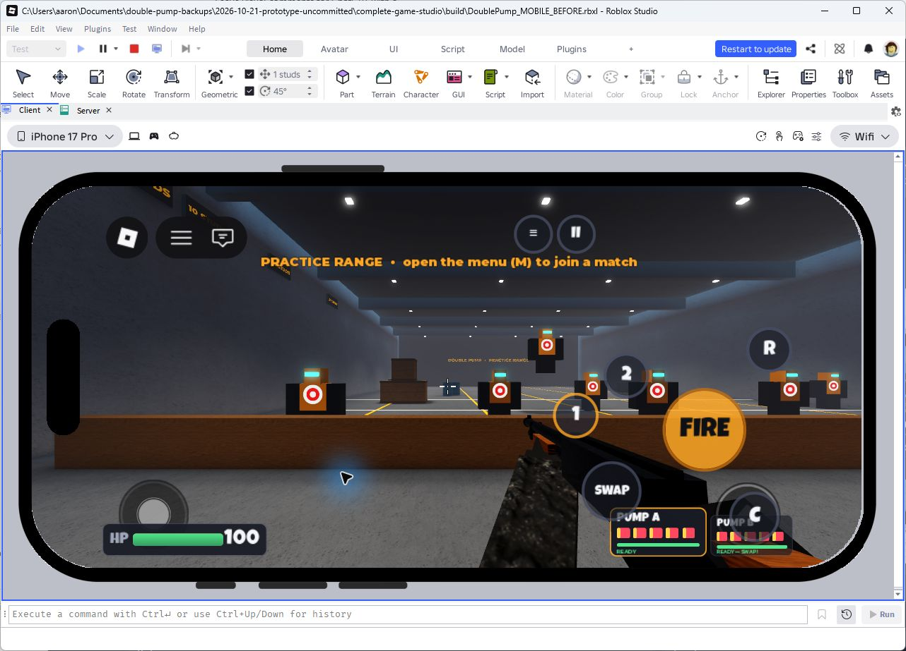
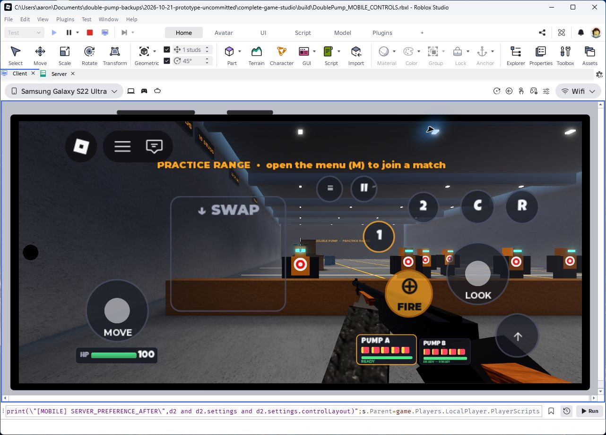
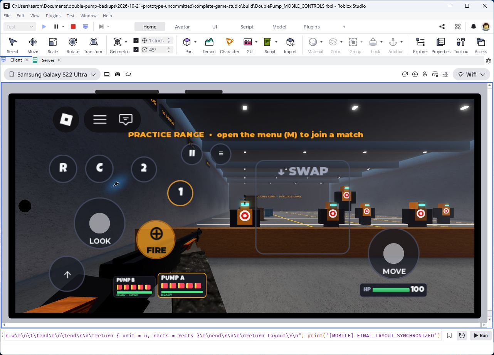

> Historical version 5 report. The published version 8 removes LOOK and separates
> UI/weapon hand. See [current revision](MOBILE_CAMERA_AND_HANDEDNESS_UPDATE.md).

# Mobile controls update

Status: **implemented, Studio verified and privately published as version 5; hardware multitouch verification pending**. Updated 2026-10-21.

## Build and preservation

Authoritative source: this isolated `complete-game-studio` checkout on
`feat/mobile-controls`, based on `a487de38a96261dbeac74e701e69ce31762123f9`.
Mobile changes are uncommitted. Existing private-release documentation changes
were retained. No merge, push, commit, asset upload or public release was performed.

Before editing, a recoverable snapshot was saved in
`../before-mobile-controls-2026-10-21/`: full Git history bundle, HEAD source
archive, existing uncommitted documentation patch, release evidence, Git status,
and `DoublePump_STABLE_PRIVATE_v2.rbxl`. The stable place and backup have identical
SHA-256 `c81b54d171a8b63eeccce8810ec138789581f8097aaacffced1d248838d1596c`.
The original prototype checkout and its independent original backup were not edited.

Candidate: `build/DoublePump_MOBILE_CONTROLS.rbxl`. It contains all **76** source
containers, byte-matched to local sources after CRLF normalization, and no extra
test scripts. Build hashes are in `docs/mobile-controls-evidence/build-hashes.txt`.
The separately reopened cloud version 5 matches all 76 source containers.
The final recoverable source/tests/place snapshot is in
`../mobile-controls-verified-2026-10-21/`. Earlier candidate snapshots remain intact.
Final Rojo place SHA-256:
`4bb38843b100c57ab3f844f9982d2f68b45340e5d311cfe4c205b7c8dff7460c`.
Studio saved edit place: `build/DoublePump_MOBILE_STUDIO_VERIFIED.rbxl`, SHA-256
`a0ccc0bc0d5e56015d732b7088c52fed02474698aebc95132ffca53f1f116d2c`.

Existing private experience only:
[Double Pump [Private Test]](https://www.roblox.com/games/82505574993280/Double-Pump),
universe **10772275012**, start place **82505574993280**, owner **supersnapstudios**.
Published **version 5** on October 21 at 2:05 PM local time. Published-only history
also retains stable version 2. Opening/downloading the cloud place also created
unpublished draft 6; published-only history still shows 5 as latest. Manage audience confirms **Only available to you and
your collaborators**. No access setting, product or asset changes were made.
The cloud copy was independently reopened in Studio and downloaded to
`build/DoublePump_MOBILE_CLOUD_DOWNLOADED.rbxl`; its 76 scripts match the final build.

## Previous implementation and before evidence

The original 150-reference-pixel FIRE button at approximately (86%,62%) also
accepted drag-look. The 104-pixel SWAP button at (73%,79%) switched weapons on tap.
Roblox's built-in movement and jump controls were active. Reload, crouch, explicit
slot selection, scoreboard and menu were custom buttons. Two original weapon
cards sat at the lower right and overlapped the jump/crouch area on a phone.
The custom first-person camera already supported mouse, gamepad and touch deltas;
the weapon controller handled client prediction and server reconciliation.

Actual original Studio iPhone 17 Pro landscape screenshot:

## New controls

- **LOOK** replaces the old FIRE position: a fixed circular two-axis rate joystick.
  Hold off-center for continuous rotation; release returns the knob and look vector
  to zero. It uses the existing touch sensitivity. Free touch drag and mouse delta
  rotation are suppressed while this mobile camera path owns aiming.
- **FIRE** replaces SWAP, slightly higher. Press fires once if eligible. Holding
  alone never repeats or buffers a future shot. Release ends ownership immediately.
  The local reticle glyph requires no uploaded image. Pressed/released states differ.
- **↓ SWAP** is a dedicated open region on the movement side, outside the movement
  stick and other controls. A fresh, quick downward touch gesture switches guns.
  If FIRE is still held, one pending shot waits for the real equipped weapon state
  to become eligible, then consumes its intent before calling the original shot path.
  A release, rejection, menu, focus loss, death/reset, explicit reload or slot input
  cancels it. Invalid gestures do nothing. One continuous drag cannot repeat.
- A fixed **MOVE** joystick and **jump** button replace the built-in touch controls
  so the entire scheme can mirror reliably. The standard PlayerModule controls are
  disabled only in touch mode and re-enabled for keyboard/gamepad. Movement uses
  camera-relative `Player:Move`; existing speed, air control, jump height and crouch
  behavior remain in the original controllers.
- Crouch is directly above LOOK, sharing reload's vertical center. Original ammo
  cards retain their appearance, ammo updates and equipped emphasis, move left of
  jump, and scale with the centralized safe-area layout. Health moves away from MOVE.
- Explicit A/B, reload, crouch, jump, scoreboard and menu remain accessible. The
  layout editor saves separate v2 positions, rejects overlapping/out-of-bounds
  overrides and preserves the old layout data for rollback.

## Handedness

On touch-capable devices, Settings → Controls → **Control Layout** offers
**Right-Handed** (default) and **Left-Handed**. All touch controls, gesture region,
health and ammo placement reflect horizontally; A/B card order reflects too.
Centered HUD/crosshair stays centered. Camera and movement directions are unchanged.

Left-handed first-person presentation reflects camera-local weapon offsets,
sway/wall transforms and animation deltas, and swaps the grip/support arm assignment.
The existing model, muzzle/shell attachment point calculations and animation system
are reused. This is a proper-rotation presentation transform, not a negative-scale
mesh replacement. Third-person guns, shot origins, pellet paths and server damage
are unchanged. Both hands and recoil/pump/reload presentation were inspected in Studio.

`controlLayout` and `touchLayoutV2` use the existing debounced SettingsAction save,
server settings whitelist and profile storage. Profile version is now **2**, with
a v1 migration retaining progress and legacy layout data. The DataStore name remains
`DoublePump_Profiles_v1`. Preference application is independent of character/map
lifetime. Live DataStore rejoin persistence has not yet been observed for this update.

## Configuration and responsibilities

`src/shared/Mobile/Layout.luau`: responsive bounds, mirroring, safe override checks.
Logical GUI pixels are relative to `DeviceSafeInsets`; both controls and mobile HUD
use this same space. Unit = clamp(min(width/844,height/390),0.8,1.5). Portrait has
an alternate arrangement. Touch bounds equal the visual button bounds.

| Setting | Value |
|---|---|
| Swipe maximum duration | 0.30 seconds |
| Swipe minimum downward distance | 72 × responsive unit logical pixels |
| Vertical/horizontal dominance | 1.8 |
| Maximum upward excursion | 16 × responsive unit pixels |
| LOOK deadzone | 0.12 |
| LOOK response exponent | 1.35 |
| LOOK maximum angular rate | 3.6 rad/s × existing touch sensitivity |
| LOOK / MOVE diameter | 104 × unit |
| FIRE diameter | 78 × unit |
| Jump diameter | 72 × unit |
| Reload / crouch diameter | 56 × unit |

`TouchState.luau`: separate finger ownership, fresh swipe recognition and joystick
math. `FireSequence.luau`: held state and one cancellable follow-up intent, without
timers, remotes or private cooldowns. `Presentation.luau`: viewmodel reflection.
`UI/MobileControls.luau`: Roblox input adapter, buttons, movement and lifecycle.
The existing CameraController, WeaponController, Hud, Settings and profile pipeline
remain responsible for their original systems.

No weapon/configuration, damage, spread, cooldown, scoring, map, team, respawn,
progression reward, monetization or third-person asset changes were made.
Original timing remains 1.0 s per gun, 0.4 s global interval, 0.15 s swap,
0.35 s spawn equip. Desktop/gamepad action bindings and firing path are unchanged.

## Automated verification

**168 passed, 0 failed**: all 124 previous tests plus 44 mobile regressions.
Tests cover valid/invalid/expired/up-then-down gestures, scaled thresholds,
one intent per fresh touch, simultaneous independent control ownership, joystick
deadzone/clamping, holding without repetition, rejected early presses without a
late shot, reload interruption, legal 0.4 s alternate and 1.0 s same-gun eligibility,
release/death/menu/reconciliation cancellation, callback reentrancy, empty-gun
consumption, reflection matrix integrity, v1 migration and settings save/load.

Layout tests cover **568×320, 640×360, 844×390, 932×430, 1024×768, 1366×1024,
320×568, 390×844**, both hands. They assert all touch/HUD rectangles stay inside
bounds and do not overlap, exact horizontal reflection and crouch/reload alignment.
These mathematical checks do not establish Roblox rendering or touch comfort.

- Rojo build: pass; local/build source identity: 76/76, no extra scripts.
- Luau LSP type analysis: pass, no source diagnostics. The existing definitions
  loader prints its informational file line and file-watch registration warning.
- StyLua: pass using Windows line endings and expanded PowerShell tool paths.
- Selene source lint: 0 errors, 0 warnings, 0 parse errors. API dump retrieval
  needed normal network permission; rerun succeeded.
- Existing unknown/disabled product warnings in tests are expected assertions,
  not monetization activation.

Exact output is saved in `docs/mobile-controls-evidence/`.

## Actual Studio observations

Environment: Windows, Roblox Studio **0.744.0.7441077**, solo Play with touch
emulation. Baseline: iPhone 17 Pro landscape. Final rendering checks: Samsung S22
Ultra **772×360** and Samsung Tab A9+ **960×600**, both handedness modes. iPhone
**874×402** was also tested during iteration. Mathematical portrait coverage above
is not a rendered portrait or device-hardware pass.

| Scenario | Observed result |
|---|---|
| Startup / Practice | 10 targets constructed and visible; HP 100 after spawn |
| FIRE taps | Pump A and B fired; ammo decreased; server snapshots agreed |
| LOOK horizontal / vertical / diagonal | Correct axes; knob recenters; release drift 0 after 0.4 seconds on three drags |
| Unheld downward swipe | One swap, no shot |
| False positives | Movement-stick downward drag, horizontal/upward/short gesture drags did not swap |
| Left-Handed selector | Actual Settings UI immediately mirrored controls, ammo cards and local weapon |
| Reload | Status/animation began; Pump B ammo returned from 4 to 5 |
| Mirrored swipe | Right-side gesture switched B to A once |
| Respawn | Actual core-menu respawn restored HP, controls and Right-Handed preference |
| Jump | Unobstructed touch button visibly raised the character/camera after respawn |
| Preference save | Server GetProfile returned Left-Handed, then Right-Handed after Settings save |
| Desktop regression | Normal HUD/camera; mouse fired both guns; Q swapped; R restored ammo |

Final spacing moved menu/scoreboard below the practice banner and Roblox core UI.
Crouch is above LOOK and aligned with reload; jump, ammo and FIRE have separate
visual/touch bounds. No new mobile source runtime errors were observed.

### Instrumented live client/server integration

A temporary PlayerScripts LocalScript exercised FireSequence with the running
original WeaponController and real server. Holding alone for 1.25 seconds produced
one shot. A deliberate simulated swipe sequence produced:

| Shot | Client timestamp (seconds) | Accepted server counter |
|---|---:|---:|
| A | 1792615320.419245 | 4 |
| B | 1792615320.857841 | 5 |
| A | 1792615321.487971 | 6 |

Intervals: **0.438596 s** and **0.630130 s**; same-gun A interval **1.068726 s**.
Server counters matched; no shot rejection was recorded. Holding another 0.8 s did
not repeat. Shot 7 followed by swap and immediate release produced no follow-up
shot over 1.2 s. This validates combat integration with simulated intent, **not
physical multitouch**, UI hold delivery, human cadence or competitive comfort.

The early observer was installed in the command-bar VM before the correct
PlayerScripts observer. Some DOWN/UP/LOOK_DRIFT/snapshot lines appear twice;
combat Fired events were not duplicated. Stopping Play removed all probes. Local,
Studio and separately reopened cloud copies match all 76 source containers.

### Screenshots and evidence

Files under `docs/mobile-controls-evidence/`:

- `01-before-phone.png`: original mobile UI.
- `06-final-tablet-right.png`, `08-final-tablet-left-viewmodel.png`: final tablet / both hands.
- `07-handedness-settings.png`: actual Control Layout selector.
- `09-final-small-phone-left-viewmodel.png`, `10-final-small-phone-right-viewmodel.png`: final phone / both hands.
- `11-after-respawn.png`: restored controls.
- `12-jump-button-test.png`: pre-jump state; the later jump was observed but not saved here.
- `13-desktop-fire-swap.png`: normal desktop UI and both ammo counts reduced.
- `14-private-audience.png`, `15-published-version-5.png`: restricted access and published versions 5/2.
- Images 02–05 are intermediate layouts, superseded by 06 and 08–11.
- `studio-runtime-observations.log`: touch, shots, counters, preference and respawn observations.
- `cloud-source-verification.log`: cloud/final source comparison.
- Probe `.luau` files document instrumentation; none are published game scripts.

## Remaining checks and limitations

**Unverified:** physical simultaneous MOVE + LOOK + FIRE + swipe, slow drags on
hardware, touch comfort/latency, physical notches/rotation, live DataStore rejoin,
left-handed respawn, left-handed mode/map transitions, this update's two-client PvP
and full match/map cycle, and measured device FPS/memory. No gameplay video was
captured. Owner has phone/tablet available and received the private link/checklist.
No new normal-Player or hardware gameplay pass is claimed yet.

Crouch and animation-transition combinations need hardware testing. The layout
editor supports safe dragging/reset; saved scaling is supported but the old resize
chips were not retained. Existing model art is reused. Existing warnings include
unapproved `swoosh.wav`, moderated sound 911864050, wrong-type asset 203785492 and
avatar wrap meshes. These did not block observed Practice/combat. Audio completeness
was not repaired or verified; no assets were uploaded and no new IDs are required.

Studio recovery is complete. Owner-approved closure of unrelated stuck sessions
followed independent backups; see `../STUDIO_RECOVERY_2026-10-21.md`.

## Phone/tablet checklist and rollback

1. Leave any old session and rejoin the private experience; enter Practice.
2. Aim in all directions; release LOOK and verify rotation stops. Hold FIRE alone:
   one shot, no repeating shots.
3. Keep FIRE held with one finger; swipe down in the marked SWAP region with another.
   Repeat, then release before a pending shot. Check ammo and no extra shots.
4. Keep moving with a third finger. Movement-stick drags must never swap. Try
   horizontal/up/short/slow drags, jumping, crouching, reload and other buttons.
5. Change Control Layout, repeat on the opposite side, respawn and rejoin. Check
   persisted preference, camera and both weapon animation/effect presentations.
6. Report device/model, orientation and exact steps; a screen recording is useful.

Stable version 2 remains in Creator Dashboard version history and in
`../before-mobile-controls-2026-10-21/DoublePump_STABLE_PRIVATE_v2.rbxl`.
To roll back, restore/open version 2 and publish to the same private start place,
or open the stable backup. Any rollback publication still needs owner authorization.
Keep the history bundle, source ZIP and stable/final places; never reset the prototype.
