# Double Pump FPS — Studio playtest report

Date: 2026-10-21 (America/Los_Angeles). Latest status: three local repairs implemented,
automated checks complete, corrected-build solo/two-client baseline verified in Studio.
The separate respawn counter mismatch is now reproduced and remains unfixed. See
[completed Studio retest](#completed-corrected-build-studio-retest).

The sections through “Reopened session” are the historical, unchanged-implementation
playtest. Their “no fixes” and detached-HEAD statements describe that earlier session,
not the subsequent authorized fix branch. Screenshots below are pre-fix evidence.

## Build and isolation

- Repository: https://github.com/aaronmginsburg-code/double-pump
- Authoritative implementation: PR #2, `claude/full-game-build-3jb3hx`.
- Tested commit: `14848886bfec43bd5277564ffce89c938f46f629`. GitHub branch and PR head were rechecked and have not advanced since the takeover audit.
- Isolated checkout: `C:\Users\aaron\Documents\double-pump-backups\2026-10-21-prototype-uncommitted\complete-game-studio` (detached HEAD).
- Initial local place: `build/DoublePump_STUDIO_TEST_ONLY.rbxl`, originally 212,060 bytes. Studio saved/re-serialized this artifact on closing (177,062 bytes). Source files remained unchanged.
- Reopened test uses a fresh build: `build/DoublePump_STUDIO_REOPEN_AS_WRITTEN.rbxl`, 212,060 bytes, byte-identical to the initial Rojo build.
- Place SHA256: `12255764cf6c8a9904824f76bc96fd5d059807ed47cfb589ca09d3144e8550de`.
- A fresh clone was made from the separate audit clone, with independent Git objects. No prototype files were copied. No branch was merged. Original checkout untouched.
- Read AGENTS.md, CLAUDE.md, AI_HANDOFF.md, PROJECT_STATUS.md, TESTING.md, ASSET_UPLOAD_MANIFEST.md, project configuration and typecheck script.
- Source/configuration remain at the tested commit. Gameplay values unchanged: same gun 1.0 s, global interval 0.4 s, swap 0.15 s, initial equip 0.35 s. Solo-match override and hold-to-fire remain false. Products remain disabled.
- New documentation and screenshots are the only intended tracked-tree additions. Build products/logs are ignored files. No uploads, publish, purchases, account/game settings changes, commits or pushes.

## Environment and evidence rules

Windows desktop; Roblox Studio `0.743.0.7431133`; graphics log identifies Intel UHD Graphics 730. New Studio window and a local server with two simulated clients (Player1/Player2), separate from pre-existing unrelated Studio projects. Unpublished place / universe 0; no API-access setting changed. Computer-use skill used for UI control. No live Roblox server or real mobile/controller hardware tested.

Observations below are from Studio UI/screenshots/Output/logs unless explicitly marked static or unverified. Read-only diagnostic commands printed state; they did not set game properties, invoke gameplay functions, synthesize remote requests, change timings, spawn/teleport characters, or repair the failing startup. Command-bar `require` results are supplementary: Studio execution contexts can have separate module state, so they alone do not establish the LocalScript's state. Direct server object properties and UI behavior are stronger runtime evidence.

## Automated checks rerun

| Check | Result / scope |
|---|---|
| Lune 0.11.0 tests | 120 passed, 0 failed. Expected disabled/unknown receipt warnings. |
| luau-lsp 1.70.1 | Direct analyzer invocation using Rojo sourcemap and downloaded Roblox definitions: exit 0, no type errors. Generated animation data excluded as in existing script. |
| StyLua 2.6.0 | Pass with `--line-endings Windows`; Windows Git checkout uses CRLF. No formatting edits. |
| Selene 0.31.0 | 0 errors, 0 warnings, 0 parse errors. First sandboxed API-definition download failed; network-enabled retry passed. |
| Rojo 7.4.4 | Build succeeded; sourcemap succeeded. Existing source folders map to Shared, Server, Client and character Health; assets map to ReplicatedStorage.Assets. |
| Source integrity | `git diff --exit-code HEAD -- src default.project.json tools tests` clean. |

The shell typecheck wrapper was inspected; it masks failures using `|| true`. Its underlying analyzer was run directly to retain the actual result. Tests exercise fake Roblox services and do not validate runtime capabilities, spawning or input wiring. Original automatic checks all pass despite the runtime defects below.

Logs: [unit tests](playtest-evidence/automated-tests.log), [type analysis](playtest-evidence/typecheck.log), [build inventory](playtest-evidence/build-inventory.log), and filtered Studio logs alongside these files.

## Solo results

| Test | Actual result |
|---|---|
| Open correct local place | Pass; full Double Pump menu loaded from the named local build. |
| Server startup | Partial failure: MapService startup exception; later services continue and print “server ready.” |
| Main menu / HUD | Menu navigation and Practice button work; health/ammo HUD and F2 overlay display. |
| Practice range | Failed: blank sky, no range geometry/dummies/player, HP 0. |
| Spawn / first-person combat / movement / jump / crouch | Blocked in solo because no practice spawn exists. |
| Shotgun asset | Stand-in warning appears; imported meshes absent. |
| Persistent data | Expected warning: unpublished place uses in-memory profiles. Persistence not tested. |

First solo Output at 00:32:03.120:

> [Double Pump] MapService failed to start: The current thread cannot write 'FallenPartsDestroyHeight' (lacking capability PluginOrOpenCloud)

Static link: `src/server/Services/MapService.luau:216` writes the restricted property before `loadRange()`. This exception prevents the range and its spawn markers from being created; PracticeService consequently starts with no dummy markers. Do not confuse this with missing cosmetic assets.

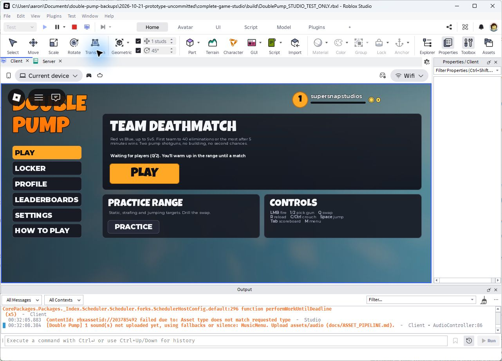
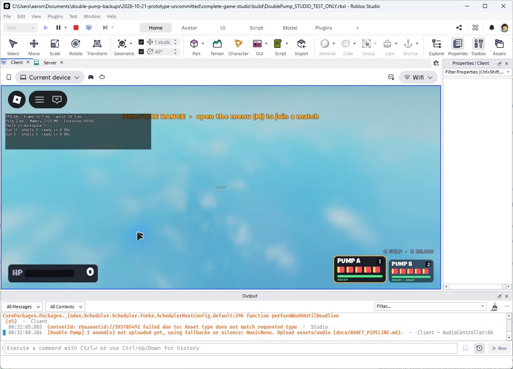

## Double-pump and weapon tests

Two clients were deployed normally through PLAY, allowed to finish intermission/countdown, and reached Active matches. LMB was attempted in both clients; Q in Player2 and direct slot 2 in Player1 did not switch. Both ammo counts remained five and Pump A remained selected. No shot/recoil/tracer/consumption was observed. No legitimate PvP damage could be produced.

Static investigation: `src/client/Controllers/WeaponController.luau:54` initializes `active = false`; `canAct()` requires it; repository search found no assignment enabling it. This independently explains fire/equip/reload being blocked. Supplementary command-bar output at 00:38:11.167 was `DPTEST Player2 false`.

| Requested validation | Result |
|---|---|
| Fire A → switch B → fire B → switch A / repeated sequence | Cannot complete: firing and switching have no observed effect. |
| Rapid switching / premature firing | Not meaningfully testable; no ordinary action succeeds. |
| Reload interruption / animation transition firing | Not meaningfully testable; no shells can be spent or reload initiated. |
| Server accepts valid / rejects premature shots | Unverified; failed local actions do not demonstrate server rejection. |
| Shot timestamps / single-versus-double cadence | No successful shots recorded; no cadence measurement available. Config values are not measurements. |
| Responsiveness / intended firing-rate advantage | Failed baseline usability in this build; advantage cannot be assessed through play. No timing values changed. |

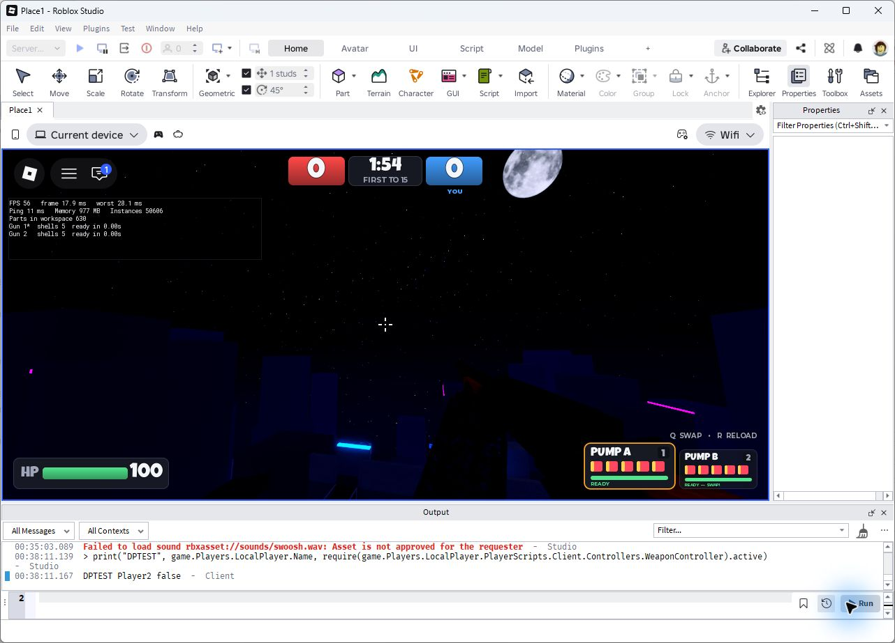

## Multiplayer and spawning

- Two simulated players connected, deployed, and were assigned opposing Red/Blue teams.
- Observed intermission/countdown, a five-minute match, 60-second sudden-death overtime, a 0–0 draw, MVP/results/reward screen, and a subsequent Warehouse round.
- Small-lobby target displayed FIRST TO 15; timer and team indicator replicated.
- Both clients showed severe view obstruction by character parts/geometry. This is an observed symptom, not proof of a standalone camera defect.
- Direct server diagnostics on Warehouse at 00:43:02 show both players near map origin rather than team spawn rooms:
  - Player1 Red: `(0, 34.096313, 0)`, nearest own spawn 73.169067 studs away.
  - Player2 Blue: `(-0.008301, 38.218262, -0.008789)`, nearest own spawn 75.158142 studs away.
  - Both had WalkSpeed 20 and Frozen=false. Range remained nil. Arena was Warehouse with 894 descendants.
- A normal Roblox-menu Respawn was requested for Player1. ELIMINATED and “Respawning in 2.2” appeared; a new alive character returned with HP 100 and both full guns. This verifies ordinary reset/respawn flow, not PvP elimination or exact respawn timing.
- W, Space and C were attempted; brief input/screenshot samples did not establish reliable navigation, jumping or crouch behavior. Marked unverified rather than passing.
- M opened the in-match menu. Locker rendered existing skin cards; no purchase/equip operation performed.
- PvP damage, hit registration, assists, kill scoring, spawn-protection damage rejection, weapon-effect replication and dynamic team rebalance are blocked/unverified. No synthetic damage was injected to claim these passed.

Static candidate for wrong spawn placement: CharacterService pivots the new character before waiting for HumanoidRootPart. This is a hypothesis to investigate, not a proven root cause. No teleport workaround was applied.

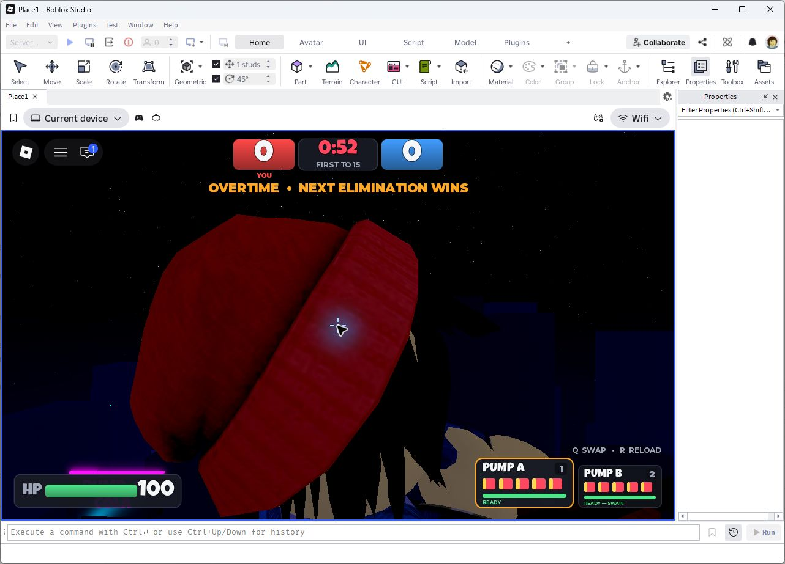
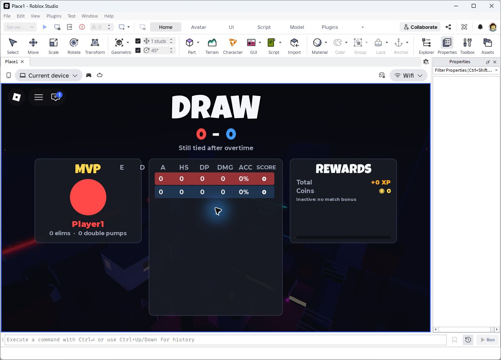
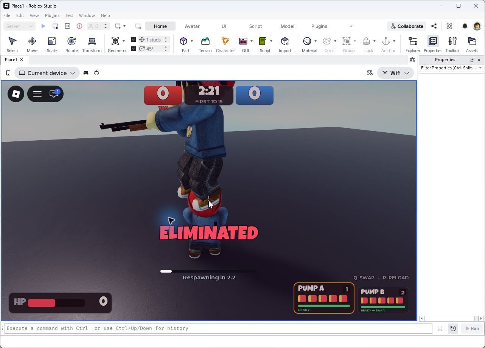

## Maps

| Map | Runtime coverage | Remaining |
|---|---|---|
| Practice | Startup attempted; absent due MapService exception. | All navigation/dummy/collision tests blocked. |
| Rooftops | First multiplayer arena loaded. Nighttime/neon geometry seen; obstructed client view. | Traversal, cover, falls, spawn safety and combat sightlines unverified. |
| Warehouse | Normal next round loaded. Server view shows office, racks, catwalks, cover and lighting. Client spawn outside intended rooms confirmed. | Navigation, collision and combat validation blocked by player/spawn issues. |
| Dust Town | Reopened session selected it normally. Client and server screenshots show desert buildings, fountain, stalls, cover and lighting. | Full traversal/collision/combat still blocked or inconclusive. |

Static layout tests passing are not a substitute for Studio collision/navigation testing.

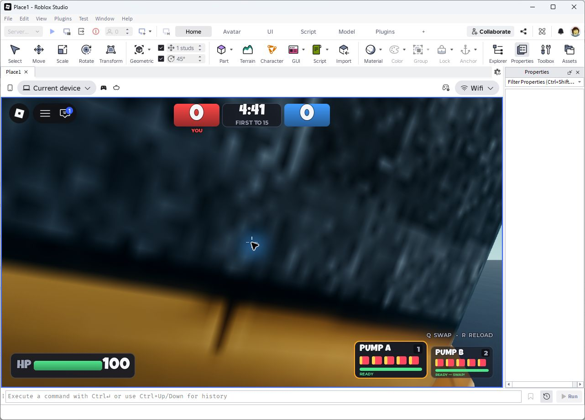
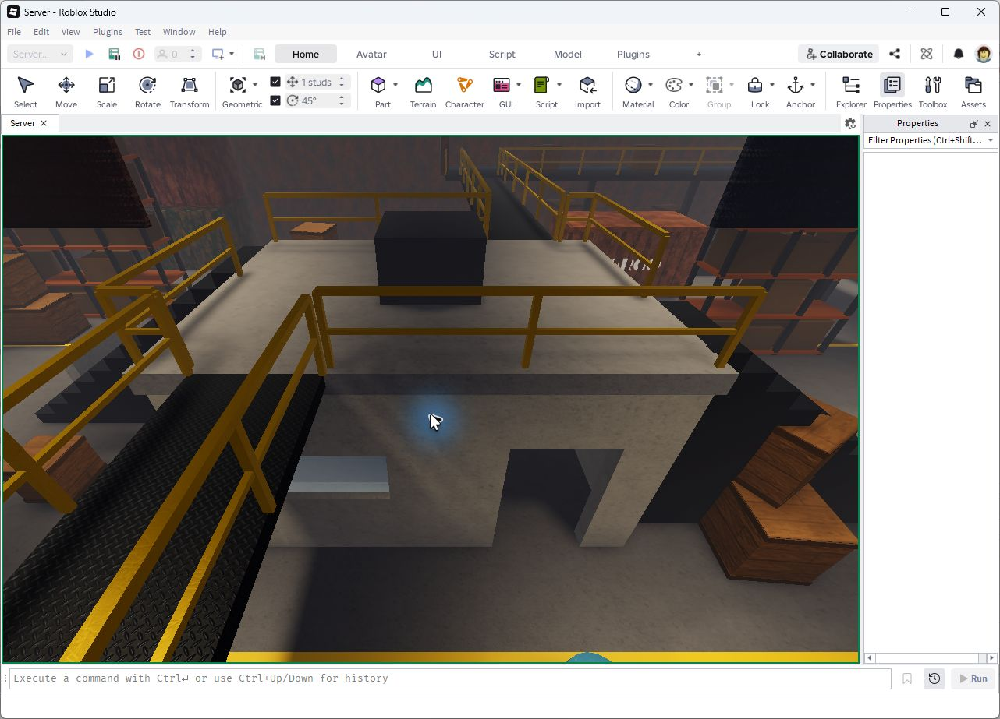

## Runtime/performance

Actual F2 snapshots (local Studio only; other Studio projects were open):

| Situation | FPS / frame | Worst frame | Memory | Instances | Parts | Ping |
|---|---|---|---|---|---|---|
| Solo missing range | 60 / 16.7 ms | 18.3 ms | 2125 MB | 49145 | 1 | 2 ms |
| Two-client Rooftops sample | 47 / 21.2 ms | 36.2 ms | 1097 MB | 50606 | 630 | 5 ms |
| Later Rooftops sample | 60 / 16.7 ms | 19.7 ms | 1090 MB | 50606 | 630 | 6 ms |
| Output-panel interaction sample | 43 / 23.2 ms | 171.0 ms | 1097 MB | 50606 | 630 | 10 ms |

These are point samples, not benchmark averages, budgets, or proof of launch performance. Studio startup log reports solo playable time 2.9662 s; this is not map generation time. Map generation duration, bandwidth and post-match memory cleanup have not been measured. Overlay instance/part figures are Stats counters, not arena-only counts.

Other actual warnings/errors:

- DataStores unavailable in unpublished place: expected environmental limitation.
- Missing shotgun asset: expected cosmetic fallback.
- MusicMenu missing: silence; other original sounds remain unintegrated.
- Built-in fallback `rbxasset://sounds/swoosh.wav` fails (“Asset is not approved for the requester”).
- ContentId `203785492` asset-type mismatch appeared even before Play. Attribution to game code is unverified; source search found no such ID.
- Roblox CorePackages UIBlox FoundationProvider warnings: engine/core UI warning, not attributed to game code.

## Previous respawn pellet-pattern defect

Actual ordinary respawn was observed. The specific fire-before-death → respawn → fire mismatch could not be reproduced through gameplay because no valid initial shot was possible. Both guns remained full. Do not describe this as Studio-confirmed divergence.

Static evidence remains: WeaponState.reset retains shotCounter, client Reset uses WeaponState.new (zero), and spread rotation depends on counter. Prior takeover's isolated Lune probe reproduced server shot 2 vs client shot 1 after one pre-reset shot. That is separate logic evidence, not a result of this Studio session. No counter values were changed or forced shots injected.

## Missing assets

Imported FP/TP shotgun and spent-shell .rbxm files absent. Parts stand-ins observed. All 29 original sound IDs and three map image IDs remain empty; no original audio uploaded. Vote images/logo cannot be verified as integrated. Lack of cosmetics does not explain the practice startup exception, wrong spawns or disabled weapon actions. No models replaced or assets uploaded.

## Prioritized findings

| ID | Classification | Evidence and reproduction |
|---|---|---|
| DP-01 | Critical | Start local Play → choose Practice → blank sky/HP 0. Output shows restricted FallenPartsDestroyHeight write aborting MapService. Reproduced solo and local-server startup. |
| DP-02 | Critical | Deploy two players, wait for Active, click LMB / press Q or 2. No fire/swap/ammo change. Static source initializes weapon active=false and never enables it. Core mechanic cannot be playtested. |
| DP-03 | Major | Normal multiplayer spawn/round transition puts opponents around origin, 73–75 studs from their team spawns; characters overlap/obstruct views. Direct server coordinates recorded. Candidate early-PivotTo cause is unverified. |
| DP-04 | Minor | Results scoreboard names/columns become unreadable/overlap at the captured Studio viewport. Screenshot is evidence; responsive-layout root cause not investigated. |
| DP-05 | Cosmetic | Original weapon/audio/map-image integrations absent; built-in swoosh fallback fails. Expected unfinished assets. |
| DP-06 | Unverified | Respawn shot-counter mismatch: logic reproduction from earlier audit, not reachable with successful shots in this Studio build. Potential impact major once weapons work. |
| DP-07 | Unverified | Movement, jump, crouch, mouse-look usability, PvP damage, assists, protection, weapon replication and real device performance require a successful baseline play session. |

No fixes implemented. Review these observations before authorizing any source change; preserve the double-pump design and all existing tuning during bug reproduction.

## Session termination and remaining coverage

At 00:47:54 both clients logged “The server has shut down.” The local test server exited normally (return value 0) at 00:47:57 and the isolated editor exited normally at 00:48:04. Computer-use refresh found only the pre-existing unrelated Studio windows. No code fix, artificial match completion, direct map load or teleport was used. The owner requested reopening the isolated session. The owner subsequently confirmed accidentally closing the Studio windows. This was not a game crash; the session was reopened on request. The screenshot captured shortly beforehand shows Warehouse overtime with 15 seconds remaining.

The reopened session reached Dust Town. Direct vote interaction/tally and completed second-round cleanup remain unverified. The first no-input vote led to Warehouse, but this alone does not verify explicit vote submission. The initial session did not complete a client disconnect/rejoin test; the reopened session did (see below). No four-client, full ten-player, device or live-server tests were performed.

To resume manually with the unchanged build:

1. Studio > File > Open from File: `C:\Users\aaron\Documents\double-pump-backups\2026-10-21-prototype-uncommitted\complete-game-studio\build\DoublePump_STUDIO_REOPEN_AS_WRITTEN.rbxl`.
2. Window > Output, then F5 for the solo startup reproduction. Choose PRACTICE. Expect the recorded range failure; do not change properties to hide it.
3. Stop; Test > Start Test Session > Server and Clients. Add two clients, press PLAY in both, and wait for the normal countdown.
4. Capture Dust Town when selected by normal rotation/voting. Do not change timing or solo overrides to accelerate the round.
5. After separately approved fixes, rerun fire/swap/reload, valid/invalid shot timing, PvP damage/protection/assists, reset counter synchronization and movement tests. These are currently blocked or inconclusive, not passed.

Review recommendation: address reproducible startup, weapon-activation and spawn failures in a later authorized fix task; then repeat the unchanged-design playtests before making any balance/design decision. This session provides no basis for replacing the double-pump system or changing its timings.

## Reopened session

The owner clarified that the first test windows were closed accidentally and requested reopening. A new editor, local server and two clients were reopened without changing source/configuration. A fresh Rojo build `DoublePump_STUDIO_REOPEN_AS_WRITTEN.rbxl` matches the original build SHA256 exactly. Dust Town was selected by the normal match flow; all three arena builders have now been observed in Studio, while the practice range remains absent. Its server viewport shows the central fountain, buildings, stairs, stalls and cover. The client view is again above/outside expected navigable positions; crouch press was inconclusive. No positive weapon-action result was obtained. The replacement join subsequently entered Rooftops with the same severe character-view obstruction.

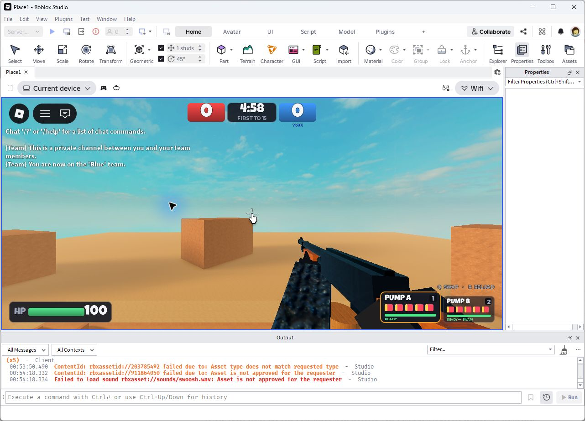
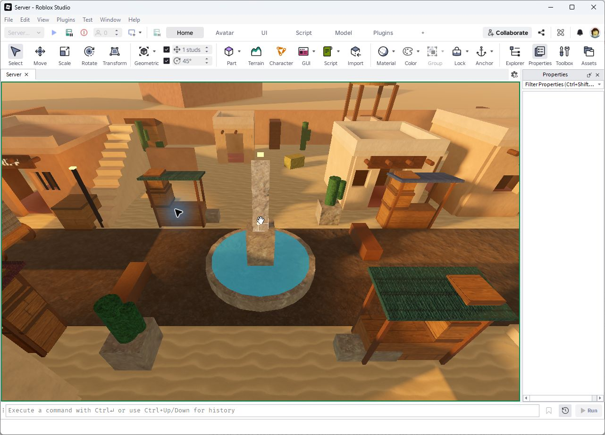

A client-only Exit Client action was used on Player1 during Dust Town. The remaining Player2 retained HP 100, a running timer and the match HUD. A replacement client was then launched normally as Player3. PLAY led to the ordinary intermission/countdown and a new Active round, Red versus the existing Blue player, with HP 100 and full guns. The previous round did not continue unchanged: fewer than two deployed players caused a return to waiting, then a new match began. This tests disconnect handling and a fresh local join, not persistence of a returning real Roblox account.

The built-place inventory confirms 2 Scripts (server entry point, character Health), 1 LocalScript (client entry point), and 69 ModuleScripts. Lune's model decoder emitted an unknown Terrain.VoxelGridAssetContentMap property warning during inventory; script enumeration completed. No missing gameplay script was found. The inventory is not evidence of successful gameplay execution.

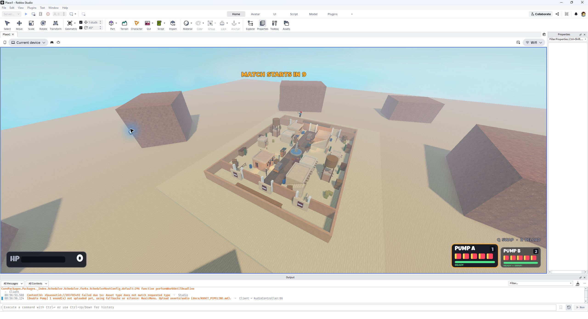
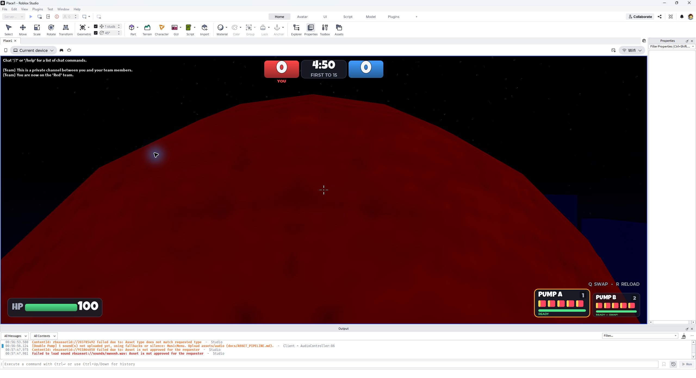

Final integrity: original prototype HEAD remains `6c77104` with the same seven modified files and untracked Rig.luau. All 52 original backup checksums still pass. The isolated source, configuration, tools and tests have no tracked diff from PR head; only this report and its evidence are new untracked documentation. No gameplay fixes implemented, no commit/push/publish/upload. Reopened editor/server and two active client windows were left available for owner review.

Coverage conclusion: startup and weapon/spawn defects limit this session. All three arenas were generated and visually inspected at least in part; complete player navigation, collision, combat and balance validation has not been achieved. Direct vote submission/tally, measured map-generation/cleanup/network cost and the post-shot respawn counter mismatch remain unverified. Runtime blockers must be reviewed before a separately authorized fix-and-retest phase. No conventional cooldown system was substituted.

## Blocker repair verification — 2026-10-21

### Identity and scope

- Base commit: `14848886bfec43bd5277564ffce89c938f46f629`; PR #2 head rechecked unchanged.
- Branch: `fix/studio-gameplay-blockers`, in the same isolated `complete-game-studio` clone.
- No fix commit exists yet. HEAD still identifies the base; verification applies to the uncommitted diff.
- Original prototype remains HEAD `6c77104debf91ca9ba9d1e30a273a774d9256898`, the same seven modified files and untracked Rig.luau. All 52 backup checksums pass after repairs.
- No changes under shared Config/Weapons or server Maps. No timing, damage, movement, match rules, prices, assets or product changes. No commits, push, merge, upload, publish or purchases.

### Root causes and corrections

| Finding | Evidence | Small correction | Verification status |
|---|---|---|---|
| DP-01 practice startup | Original Output: MapService cannot write FallenPartsDestroyHeight, lacking PluginOrOpenCloud capability. This assignment precedes loadRange. PracticeService consequently has no markers from which to create targets. | Remove runtime protected-property write; serialize the same intended -120 value in Workspace properties in default.project.json. | Regression/build and corrected solo range/10-target startup with server-confirmed damage pass. |
| DP-02 firing/switching | WeaponController initializes active=false. canAct gates fire/equip/reload on this flag; no assignment enabled it. Existing input/remotes/controller starts are present. | GameFlow.refresh sets active from the existing InputController.combatEnabled value, following live character/menu/postgame state. No weapon state-machine edits. | Lifecycle regression passes; actual mouse firing/Q switching/R reload, menu gating, respawn recovery and controlled server acceptance pass. Number-key/controller/touch input remains untested. |
| DP-03 team placement | Original server positions were near origin, 73–75 studs from team spawns. CharacterAdded pivots before the engine finishes loading/placing the character. Roblox documents final placement after this event. | Run preparation from CharacterService.spawn after LoadCharacterAsync returns; wait/check humanoid and root/current character before pivot; emit Spawned afterward. Preserve three-stud lift, protection, team selection and map coordinates. | Regression passes; actual two-client team positioning matches markers in all three arenas, with reset/elimination respawns verified in Warehouse/Rooftops. |

Loading-order reference: [Roblox Player documentation](https://create.roblox.com/docs/reference/engine/classes/Player#LoadCharacterAsync).

These are separate lifecycle/setup failures. The practice exception aborts only MapService's remaining start work because service starts are individually protected; it does not explain the independently disabled weapon flag. No evidence justified replacing the ordered WeaponAction remote or changing cooldown eligibility. Client prediction, server damage, recoil/animation, manual switching, independent shotguns and reload interruption remain implemented by their original code.

### Changed implementation and regression files

- `src/client/Controllers/GameFlow.luau`: require the existing WeaponController and synchronize its active flag.
- `src/server/Services/CharacterService.luau`: initialize after loading completes, place after required parts exist, skip invalid/currently removed characters, clear failed load request, remove the premature CharacterAdded preparation subscription.
- `src/server/Services/MapService.luau`: remove the protected write.
- `default.project.json`: serialize the intended world destroy-height value.
- `tests/studio_blockers.spec.luau`: three tests exercising the real coordinators with mocked Roblox boundaries. All three failed against original behavior and pass after corrections. Assertions in existing tests were not weakened.
- Documentation: this report, PROJECT_STATUS, AI_HANDOFF, TESTING and CHANGELOG.

### Automated results

| Check | Exact result |
|---|---|
| Pre-edit original suite | 120 passed, 0 failed |
| Repaired suite | 123 passed, 0 failed (120 original + 3 new); exit 0 |
| Direct luau-lsp 1.70.1 analysis of src | Exit 0; no type errors. Used generated sourcemap, Roblox definitions and existing ShotgunAnimData exclusion. Benign watched-file registration warning only. |
| Rojo 7.4.4 | Built DoublePump_STUDIO_BLOCKER_FIXES.rbxl successfully |
| Selene 0.31.0 src | 0 errors, 0 warnings, 0 parse errors; exit 0 |
| Extended Selene src/tests/Luau tools | 0 errors, 1 unchanged unused-variable warning at tests/validation.spec.luau:41, 0 parse errors; exit 1. Not represented as fully clean. |
| StyLua 2.6.0 src/tests/Luau tools | --check --line-endings Windows, exit 0 (checkout uses CRLF) |
| Git integrity | diff --check clean; no diff to weapon configuration/state, damage or map implementation |

Stock Selene initially could not download Roblox definitions in the network sandbox; the authorized network-enabled retries produced the results above. A first extended invocation passed a literal tools/*.luau on Windows and failed path expansion; the recorded final extended run used explicit file enumeration. No lint rule or original assertion was weakened to hide the warning. Direct type analysis was used because the existing typecheck.sh suppresses nonzero exit codes.

Automated logs: [automated-tests.log](playtest-evidence/blocker-fixes/automated-tests.log),
[typecheck.log](playtest-evidence/blocker-fixes/typecheck.log),
[build-inventory.log](playtest-evidence/blocker-fixes/build-inventory.log).
The corrected place was decoded independently: 2 Scripts, 1 LocalScript and 69
ModuleScripts, destroy height -120, corrected activation included, protected runtime
write absent. All inventory assertions passed; this verifies packaging, not startup.
Build hash: `3fe04dba4f86d9b1f084d5e47cfb0adb19372053da5804a1c989198c4fcbaf98` (SHA256, before Studio serialization).

### Initial Studio attempt (subsequently unblocked)

The installed Studio version is still 0.743.0.7431133 on Windows / Intel UHD 730. The old Double Pump server/client session was ended through Test > End Session. Its two earlier editor windows were closed to free capacity; no unrelated Studio project was closed. File > Open of the corrected build produced: “Can't open Studio window — You have opened the maximum allowed Studio windows. Please close some and try again.” Subsequent app launches exposed no usable new editor. The owner was asked to free unused Studio windows and open the exact corrected file. This is an environment blocker, not evidence that the repaired game crashed.

Corrected file:
`C:\Users\aaron\Documents\double-pump-backups\2026-10-21-prototype-uncommitted\complete-game-studio\build\DoublePump_STUDIO_BLOCKER_FIXES.rbxl`

At this initial attempt, no repaired-build Play session was observed. The owner then
cleared the window limit and reopened the corrected file. The completed retest below
supersedes this temporary limitation and the pending verification cells above.

### Original retest plan (completed results follow)

1. Open the corrected file locally; Window > Output; F5; choose PRACTICE. Confirm range, targets, HP100 and first-person camera; click to fire A, Q/2 to select B, fire, R reload; open/close M menu and confirm combat gating. Confirm target health actually changes.
2. Stop solo; Test > Start Test Session > Server and Clients; add two clients and PLAY in both. Wait for the normal countdown. Record actual root coordinates versus the selected team's marker and confirm protection. Repeat after normal death/respawn.
3. Test player-versus-player damage/elimination and respawn, both shotguns, per-slot ammo, shell insertion, switching during reload, predicted effects and remote shot replication. Observe Output on server and both clients.
4. Perform fire → swap → fire, then repeated alternation and same-gun control. Passively record actual server received/accepted shot times; measure intervals before claiming the double-pump advantage, responsiveness, premature-shot rejection or desynchronization behavior is validated. Leave all timing values unchanged.
5. Confirm Warehouse, Dust Town and Rooftops through ordinary match flow/voting. Record map generation, correct initial/respawn positions and runtime errors; do not infer full collision/navigation coverage from layout tests.
6. Reproduce the existing post-respawn shotCounter mismatch with successful shots before/after respawn. This separate known issue was not silently fixed. Client Reset still constructs a fresh state while server reset retains its counter; pattern divergence may affect hit registration and needs a scoped decision after runtime reproduction.

This plan was initially pending the window-limit resolution. The completed results
below supersede that status: DP-01/02/03 pass baseline checks, DP-06 is now confirmed,
and broader coverage/UI/assets remain open. No further gameplay fixes were applied.

## Completed corrected-build Studio retest

The owner reopened the exact corrected file; solo Play began around 02:21 PDT and
two-client testing around 02:26 PDT on 2026-10-21. Same base commit/uncommitted repair
diff and Studio version as above. Place SHA256 stayed
`3fe04dba4f86d9b1f084d5e47cfb0adb19372053da5804a1c989198c4fcbaf98`, 212,261 bytes.
The test observers/probes were inserted only into running sessions; no gameplay
source or saved place was edited to implement them.

### Actual observations and measurements

| Check | Observed corrected behavior |
|---|---|
| Solo practice startup | Range geometry, signage, stand-in gun, first-person camera, HP100 and 10 targets loaded. MapService startup exception absent. Static, strafing and jumping targets visible. |
| Ordinary controls | Mouse click fired A, Q selected B, mouse click fired B; distinct shell counts decreased. R displayed reload and replenished the active gun. Mouse drag changed aim, recoil/pump and shell ejection were visible. |
| Targets | Real mouse-aimed shot produced hit feedback. Passive server observer logged Drill Bot HP 16.913742 and two accepted pellets for the observed shot; cumulative prior solo stats were 6 accepted, 0 timing rejected, 13 pellets accepted, 0 pellet claims rejected. |
| Multiplayer | Two clients deployed normally, assigned opposing teams and entered countdown/Active. Server accepted Player2's real mouse A and B shots after Q switching; replicated Shot events appeared in the other client. |
| Initial Warehouse team placement | Player1 Red (-65,3.5,-36), Player2 Blue (65,3.5,36); zero horizontal marker offset initially, <=0.017 studs after settling. Root settles near Y3.096 above the Y0.5 marker. Both HP100; Frozen=true during countdown as intended. |
| Warehouse respawn | Normal Roblox Respawn UI → elimination → 2.5-second respawn flow. Player1 returned to (-65,3.5,-36), zero horizontal offset, HP100 and full guns; subsequent real mouse shot accepted. |
| Protection | Spawned events logged ProtectedUntil about two seconds ahead. Actual protected-vs-unprotected damage comparison not performed. |
| Reload cancellation | Controlled real-controller probe: cancel before first insertion preserved ammo1 and reloading=false; after one insertion preserved ammo2 and reloading=false. |
| Menu | M opened the existing menu; Q while open produced no weapon equip event. M resumed. Automated lifecycle test covers death/results/menu gating as well. |
| PvP | Two existing opposing player characters were positioned six studs apart in the existing range for a controlled clear line of sight. Normal client weapon code aimed/fired; no direct damage call or health edit. Ten pellets accepted, server victim HP100→0; shooter Hit event reported damage100, killed=true. Repeated in the following round with the same result. |
| Scoring/respawn | First staged kill ended Warehouse overtime naturally. Second staged kill incremented Blue to 1 in Rooftops. Victim respawned at its proper team marker in each arena with HP100. This verifies real-player damage, not only dummy damage. It does not establish ordinary traversal/combat balance. |
| Round transition/vote | Overtime elimination → results → vote → Rooftops countdown/Active observed. Normal click recorded one Rooftops vote and selected it. No artificial match completion or duration override used. |

### Controlled shot timing

The cadence probe calls the existing live client's equip/tryFire/reload methods at
scheduled times. It does not edit weapon state, ammo, clock or config. This complements
real mouse/Q/R tests; it is not a measurement of human keypress responsiveness.
Passive server ShotFired observers and the other client's replicated Shot events
confirm authoritative acceptance. Times are workspace:GetServerTimeNow() seconds:

| Case | Slot | Server accepted time | Interval from prior accepted shot |
|---|---|---|---|
| Single control 1 | A | 1792574975.229253 | — |
| Single control 2 | A | 1792574976.345377 | 1.116124 s |
| Double sequence 1 | A | 1792574977.445767 | 1.100390 s (rest before sequence) |
| Double sequence 2 | B | 1792574977.995730 | 0.549963 s |
| Double sequence 3 | A | 1792574978.778673 | 0.782943 s |
| Double sequence 4 | B | 1792574979.262368 | 0.483695 s |

Alternating interval mean: about 0.606 s for these three gaps, versus 1.116 s for the
single-gun control gap. This sample demonstrates a meaningful advantage without
changing the 1.0/0.4/0.15 rules. It is not an optimal-rate benchmark or comprehensive
validation under latency. The sample contains one deliberately premature raw remote
request, issued shortly after the third accepted shot; it produced Snapshot/Cooldown
and incremented rejected to1. A separate premature tryFire was suppressed by client
eligibility. Legitimate sequence shots remained accepted and replicated as numbers1–6.
No spontaneous timing rejection occurred in this short sequence.

### Additional confirmed defect: respawn counter divergence

Reproduction in the same ordinary local multiplayer session:

1. Player1 fires six accepted shots (the controlled sequence above).
2. Use Roblox's normal Respawn confirmation. Wait for full health/ammo at Red marker.
3. Client observer records Reset counter0.
4. Click normally to fire the first post-respawn shot.
5. Client Fired reports shot1 at 1792575063.578256. Server accepts it at
   1792575063.590845; other client receives the server Shot payload with shot7.

**DP-06 — Major, confirmed counter divergence.** Server WeaponState.reset retains its
counter while client Reset creates WeaponState.new. The deterministic pellet roll
therefore differs. The close-range staged PvP checks still accepted all ten pellets;
this does not measure the mismatch's effect on distant or edge-of-hitbox shots.
No fix was made because this is separate from the three authorized blocker repairs.
Next scoped task should synchronize respawn counters and add network/respawn regression
coverage, then measure hit-registration impact.

### Performance and limitations

Actual local F2 snapshots (point samples, not launch-performance certification):

| Situation | FPS/frame/worst | Memory | Instances/parts | Ping |
|---|---|---|---|---|
| Warehouse, two clients, stationary | 60 /16.7 /17.8 ms | 1379 MB | 51484 /1266 | 7 ms |
| Rooftops vote transition | 60 /16.7 /18.6 ms | 1358 MB | 51552 /1214 | 5 ms |
| Rooftops client spawn | 60 /16.7 /19.0 ms | 1416 MB | 51258 /951 | 13 ms |

All are this PC's Studio simulation with observers/Output; no phone, controller,
full-lobby, network-load, map-generation-duration, bandwidth or memory-leak benchmark.
No cleanup claim is inferred from these mixed point counters.

Expected limitations remain: stand-in shotgun/shells, absent original sound/image IDs,
failed built-in swoosh and fallback asset 911864050, unpublished DataStores using
in-memory profiles, and Roblox CorePackages UI warnings. Original content-ID
203785492 warning persists. No corrected MapService startup exception appeared.
A diagnostic setup initially tried server-only access to PlayerScripts and failed;
that was test instrumentation, corrected by parenting LocalScripts to PlayerGui.
It was not a game runtime defect. Probe source and filtered logs are saved below.

Full navigation, jumping/crouching usability, spawn trapping, all arena sightlines,
assists, four/ten players, latency/desync stress, live persistence and real devices
remain unverified. No asset upload or publishing occurred.

### Evidence

All new evidence is under `playtest-evidence/blocker-fixes/`:

- 01-practice-spawn.png, 02-both-guns-fired.png, 03-target-hit.png,
  04-server-confirmed-target-damage.png.
- 05-warehouse-spawn-coordinates.png, 06-cadence-reload-probe.png,
  07-warehouse-respawn.png, 08-performance-sample.png.
- 09-pvp-elimination-and-vote.png, 10-rooftops-vote.png,
  11-rooftops-spawn.png, 12-rooftops-server.png,
  13-rooftops-pvp-respawn-score.png.
- Filtered original Studio logs: solo `092017Z...27CC3`, server `092600Z...82662`,
  Player2 `092649Z...4A675`, Player1 `092650Z...455B8` (full filenames in folder).
  Filters retain diagnostic and game startup/audio warnings; original full logs
  remain in the local Roblox logs directory.
- passive-observer.luau / passive-client-observer.luau record events; cadence-probe.luau
  drives the existing controller and one explicit invalid remote request; pvp-probe.luau
  drives the real shooter after temporary actor positioning. These are test artifacts,
  not mapped into the game by Rojo. Don't include them in a production place.

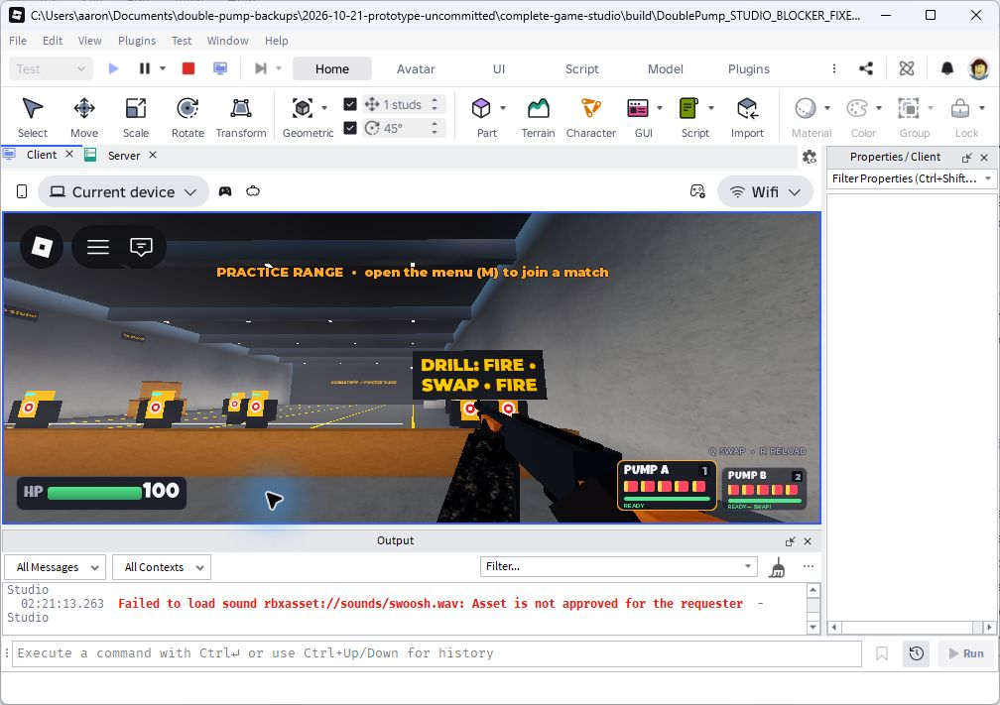
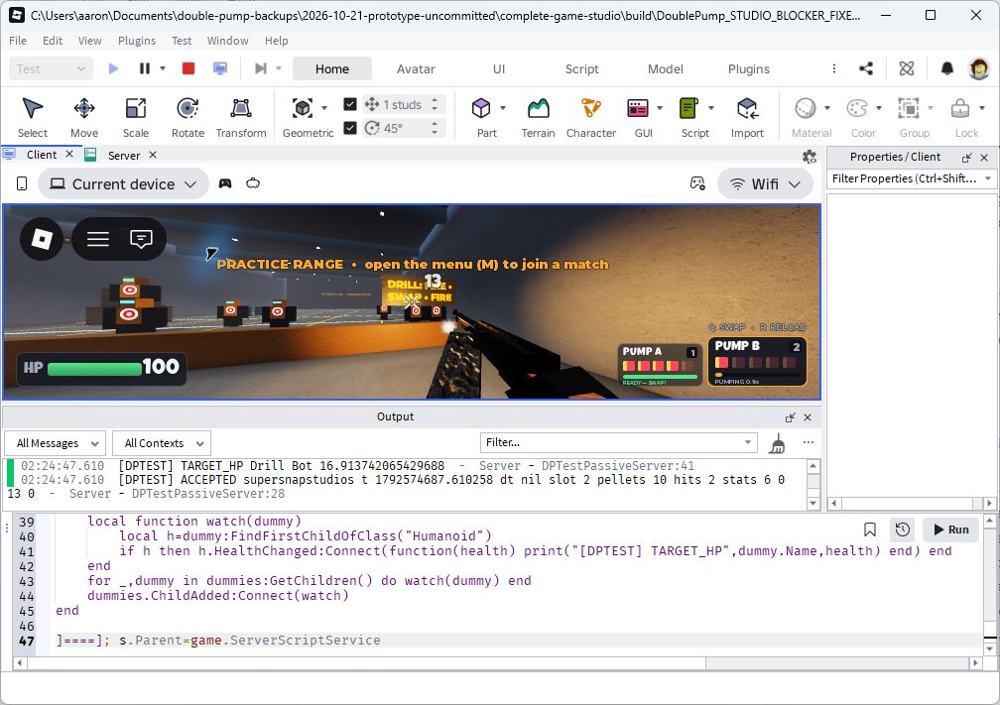
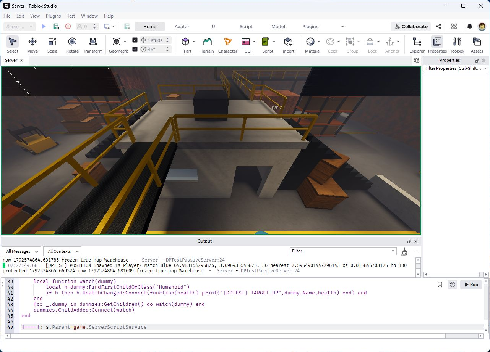
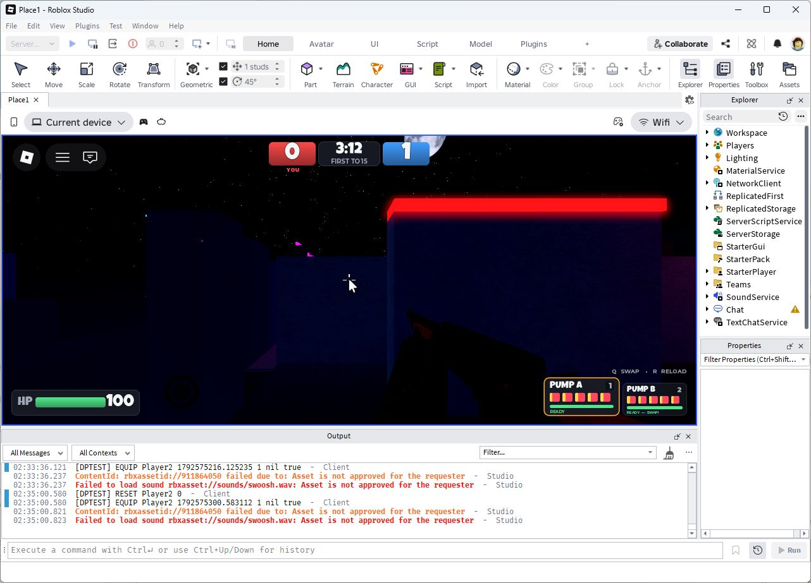

Disposition: DP-01, DP-02 and DP-03 pass the corrected baseline Studio tests described
here. DP-06 is confirmed and remains open. Missing assets/UI polish and broader
coverage remain separate. Changes are uncommitted on fix/studio-gameplay-blockers;
review before committing, merging or further fixes.

### Final arena coverage and session end

All three arenas loaded through normal match flow in this corrected-build session:

| Map | Actual placement evidence | Runtime/visual result | Limit |
|---|---|---|---|
| Warehouse | Red (-65,3.5,-36), Blue (65,3.5,36); initial XZ offset0, settled <=0.017. Normal Red reset and Blue elimination respawn also at correct markers. | Indoor hall, racks, office/catwalk geometry loaded. | Full navigation/collision/sightlines not tested. |
| Rooftops | Blue (63,7.5,-30), Red (-63,7.5,-30); initial XZ offset0, settled <=0.017. Eliminated Red respawned at (-63,7.5,-30), settled XZ0. | Neon rooftops geometry and client view loaded; actual PvP score Blue1/Red0, normal time-limit completion followed. | Dark lighting observed; full gaps/falls/traversal not tested. |
| Dust Town | Blue (70,3.5,42), Red (-70,3.5,-42); initial and settled XZ0, HP100. | Buildings, fountain, stalls, stairs/cover and lighting visible in server viewport; client spawned on the ground and entered Active. | No Dust Town death/respawn or full traversal test. |
| Range | Solo root (-1254,3.097656,29.996094), XZ0.003906 from chosen marker, HP100; 10 targets. | Actual target damage and weapons verified. | All individual target drills not completed. |

Dust Town was selected by the normal next-round flow after Rooftops' regulation
finish. A click intended for its vote card arrived as the screen transitioned; no
Dust Town vote tally was captured, so explicit Dust Town vote acceptance is not
claimed. Rooftops' one-vote tally was captured and its selection verified.

Additional issue **DP-08 — Minor, observed spawn-facing concern**: several fresh
spawn views face close walls/cover although position is correct (Warehouse and
Dust Town screenshots). Mouse-look works. Camera yaw may initialize before the
server's final spawn orientation; this is a static hypothesis, not a confirmed
root cause or a demonstrated navigation blocker. Investigate orientation alongside
normal movement/escape from spawn in the next review; no extra camera/map change
was made during this retest.

The observer reports infinite marker distance during Match-mode warmup without a
team/arena because its diagnostic lookup selects the absent arena. This is a probe
limitation, not a gameplay spawn failure. Teamed arena placement measurements above
are valid. Temporary actor positioning for PvP occurred only after baseline spawn
measurements, and was explicitly labeled STAGED_PVP_RANGE in the logs.

New screenshots: [Dust Town player](playtest-evidence/blocker-fixes/14-dust-town-spawn.png)
and [Dust Town server](playtest-evidence/blocker-fixes/15-dust-town-server.png).
All fifteen corrected-build screenshots and filtered logs are retained alongside
the original defect evidence. The local server and clients were ended normally
through Test > End Session after Dust Town verification. The corrected editor was
left open. Temporary observers/probes were not saved into the .rbxl; its hash and
source/config diff were checked. No further source change occurred during testing.

Recommended sequence: review/approve this uncommitted three-blocker diff; separately
scope the confirmed respawn counter fix and investigate spawn camera orientation;
rerun accepted-shot/claim validation across respawns and latency, ordinary arena
navigation, protection/assists and device/performance tests; then consider assets
and launch preparation. No weapon tuning or conventional cooldown substitution is
justified by these observations.

