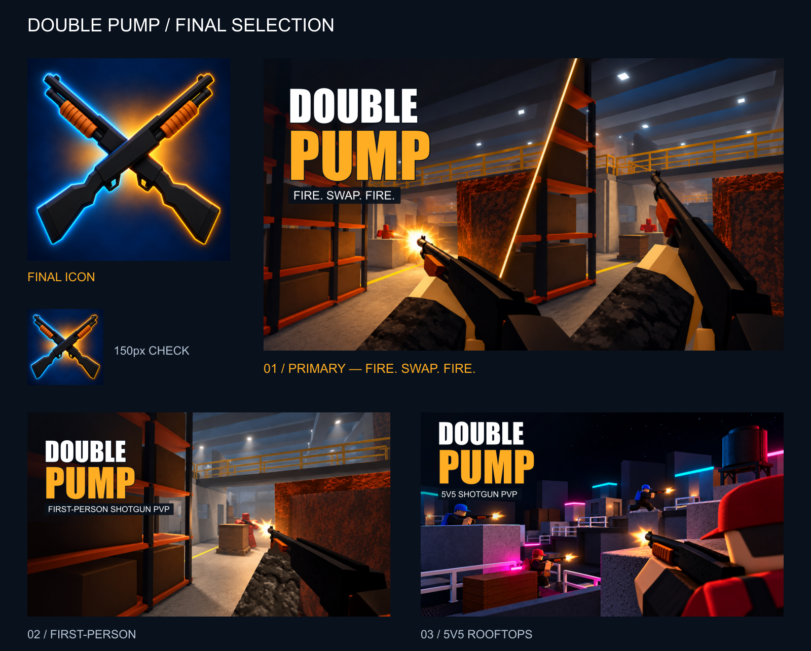
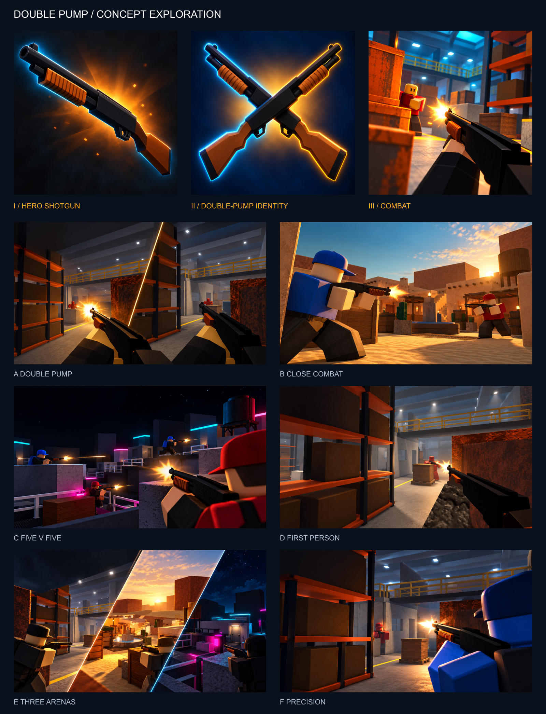

# Double Pump — marketing asset report

Created 2026-10-21 for the existing private experience (universe 10772275012,
start place 82505574993280). **No images were uploaded, no game was published, and
no audience, monetization or gameplay setting was changed.**

## Delivered selection

Use **01_DoublePump** as the initial primary thumbnail. The two editorial moments
and “FIRE. SWAP. FIRE.” communicate the switching hook; the orange Warehouse framing
connects it to the actual game. This is a creative recommendation, not a measured
click-through result. 02 is the clearest single-view depiction of first-person play;
03 adds the team format and a different arena/palette.

| Upload file in finals/ | Dimensions | Format | Bytes |
|---|---|---|---|
| DoublePump_Icon_512.png | 512 × 512 | RGB PNG | 452,220 |
| 01_DoublePump_1920x1080.jpg | 1920 × 1080 | RGB JPEG | 704,419 |
| 02_FirstPerson_1920x1080.jpg | 1920 × 1080 | RGB JPEG | 605,862 |
| 03_5v5Rooftops_1920x1080.jpg | 1920 × 1080 | RGB JPEG | 622,267 |

All are sRGB, decoded/checked after export, and below 3,000,000 bytes. The icon has
an opaque background. JPEGs use quality 96 and 4:4:4 chroma sampling. Lossless PNG
versions, original generated masters and editable SVG layouts are in editable/.
Do not upload preview/contact sheets or the capture-only Roblox place.

## Discovery and capture

Inspected the current published implementation and its actual first-person gun,
UI and practice range in Studio, then captured Warehouse in a temporary Play scene.
Read map builders and weapon presentation code before final design. The signature
shape is a dark pump shotgun with a wooden orange-brown fore-end; environments use
simple Roblox part geometry rather than photoreal military detail.

Visual strengths: orange racks and yellow catwalks create Warehouse framing;
Dust Town's adobe roofs, stalls, fountain and warm light separate it immediately;
Rooftops' white bridges, AC cover, water tanks and cyan/pink lights give a night palette.

The first Studio session stopped accepting capture input after temporary runtime
camera commands. No source or cloud save was made. Continued in a separately built,
local **CAPTURE_ONLY_V2_DO_NOT_PUBLISH** place. It uses the exact map-builder geometry,
translated far apart for isolation, disabled gameplay entry scripts and a dedicated
presentation camera. Its lighting/exposure is staging, not a claim of untouched live
match rendering. A cloned owner avatar is a static scale reference, not a live opponent.
The original capture prototype put maps too close together; that overlap was corrected
before retaining Dust Town/Rooftops captures. The V1 place is an obsolete intermediate.
The successful capture-only Play session was stopped after capture.

Raw JPEG screenshot bytes are preserved without painting or upscaling (1282 × 923,
including Studio chrome). They are references, not upload finals:

| Capture | Content / provenance |
|---|---|
| 01-practice-first-person-raw.jpg | Actual current game in Play, HUD, gun, camo sleeve and practice targets |
| 02-warehouse-first-person-raw.jpg | Actual game weapon; original Warehouse geometry; temporary camera/HUD suppression |
| 03-warehouse-environment-raw.jpg | Local capture-only Warehouse, no foreground weapon |
| 04-dust-town-lane-staged-raw.jpg | Local capture-only Dust Town lane; static owner-avatar reference; partially obstructed composition, retained as intermediate |
| 05-dust-town-wide-raw.jpg | Clearer local capture-only Dust Town architecture/fountain overview |
| 06-rooftops-staged-raw.jpg | Local capture-only Rooftops, bridges/AC/neon and static avatar reference |
| 07-rooftops-wide-raw.jpg | Wider local capture-only Rooftops silhouette |

No fresh live PvP exchange, elimination, or exact muzzle-flash frame was successfully
captured for this task. Action, muzzle flashes and rivals in the artwork are generated
illustrative staging, not documentation of an observed match. No gameplay video is
included. Existing offline map overview renders were also inspected as secondary
geometry references; they are not mislabeled as Studio screenshots.

## Three icon concepts

| Concept | Direction | Assessment |
|---|---|---|
| icon-01-hero | One diagonal hero shotgun, amber/cyan rim light | Strong shape, but less specific to two-pump switching |
| icon-02-double | Crossed pair of identical pump shotguns | Selected: two clear silhouettes, no reliance on tiny text |
| icon-03-combat | First-person Warehouse encounter | Energetic, but rival/environment become small at icon size |

Refined icon 02: darkened stocks/receivers to match the current gun, retained wooden
fore-ends, simplified spark clutter and controlled the glow. The pair is an inventory
emblem, not a claim that players fire two guns simultaneously. Inspected at full size
and 150 px; both pump silhouettes remain recognizable.

## Six thumbnail concepts

| Concept | Marketing angle | Selection |
|---|---|---|
| A — double-pump | Diagonal panels: firing one gun, raising the next | Refined into final 01 |
| B — close combat | Dust Town duel, blue versus red | Preserved as an alternate warm action direction |
| C — five versus five | Rooftops team fight and compact bridge navigation | Refined into final 03 |
| D — first person | Gun/camo sleeve and Warehouse crate encounter | Refined into final 02 |
| E — three arenas | Warehouse / Dust Town / Rooftops triptych | Preserved as map-variety alternative |
| F — precision | Over-shoulder Warehouse duel | Preserved; overlaps final 02's combat message |

## Hybrid production and refinement

Built-in image_gen was used, with the real Studio captures supplied as explicit
weapon/environment references. Concepts keep the recognizable map vocabulary and
single pump shotgun per combatant. Final A uses two sequential editorial panels;
D is one continuous first-person view; C shows four visible combatants from a 5v5
format. It does not imply four is the server limit. No purchased skins or exclusive
character costumes are promised by the illustrative red/blue avatars.

The finals are **screenshot-guided promotional illustrations**, not pixel-identical
raw screenshots. Compositions, avatar poses, light emphasis and effects are curated;
exact map coordinates and opponent appearances are not literal match captures.
No extra weapon classes, building system, powers or destructibility were introduced.
Original typography and composition do not use Fortnite/Arsenal logos or copied art.

Refinement passes preserved the actual dark gun/wooden pump combination, matched
camo sleeves, made the second swap panel distinct and removed the Rooftops concept's
long laser-like streaks. Custom editable SVG graphic layouts add large white/amber
DOUBLE PUMP lettering and short factual captions. Titles leave weapons/encounters
visible; the Rooftops caption was moved upward after inspection to clear a player.
All essential copy is above the bottom metadata zone. A first preview-board export
had a JPEG MIME mismatch; it was corrected and the final board re-rendered/inspected.

Generation prompts and reference lists: editable/concept-prompts.json and
editable/refinement-prompts.json. Final icon refinement prompt is also recorded.
The built-in tool was used, not the API/CLI fallback. Generated art is flattened;
SVG title, gradient and caption objects remain separately editable. There is no
layered PSD or separately editable character rig. SVGs use Windows Impact and Arial;
other systems may need matching fonts or outlined text before re-export.

Generated thumbnail masters are 1672 × 941; they are fitted to the exact 1920 × 1080
export canvas with native-resolution vector typography. The original 1254-square
icon master is retained. Raw screenshots were not claimed as native 1920 captures.

## Export specifications checked

Verified Roblox's current official documentation on 2026-10-21:

- [Experience icons](https://create.roblox.com/docs/production/publishing/experience-icons):
  square, at least 512 × 512; inspect small previews such as 150 × 150.
- [Thumbnails](https://create.roblox.com/docs/production/publishing/thumbnails):
  16:9, ideally 1920 × 1080; JPEG and PNG supported. Home-page upload guidance says
  keep images below 3 MB. Important content should avoid the bottom metadata area.

No moderation acceptance or actual browsing CTR is claimed; those require upload
and live platform feedback. UPLOAD_INSTRUCTIONS.md gives the existing target and
recommended order without changing its private access.

## Preservation and checks

Checkout: feat/mobile-controls, base a487de38a96261dbeac74e701e69ce31762123f9,
with the prior uncommitted mobile/camera work preserved. The owner reported that the
latest revision works properly. No new gameplay source changes were made in this task.
The existing before-camera-hand-revision and camera-hand-verified backups remain.

Repository checks rerun: **197 passed, 0 failed**; Rojo builds; all 78 current local
sources match the prior verified candidate; StyLua passes using Windows line endings;
Selene reports 0 errors / 0 warnings / 0 parse errors; Luau analysis has no source
diagnostics (existing definition/file-watch informational warning only). The first
Windows wildcard formatting invocation and sandboxed Selene definition fetch failed;
proper expanded file arguments and permitted definition access succeeded afterward.
Logs and hashes are retained under editable/.

Source-check place and capture-only places are local support artifacts only. Never
publish a CAPTURE_ONLY place: its gameplay scripts are intentionally disabled.
No commit, push, merge, asset upload, purchase or cloud publication occurred.
